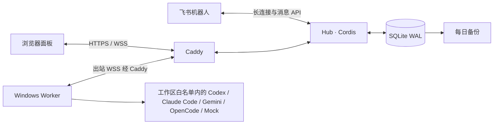

# Agent Hub

Agent Hub 把飞书或浏览器里提交的任务交给指定 Windows 工作区里的 CLI 执行。Hub 负责审批、调度、日志和审计。Worker 使用本机登录的 CLI，经出站 WebSocket 接收任务、回传进度和结果。



## 本地联调

在仓库根目录使用 Node.js 24 与 pnpm 11.17.0。首次执行以下命令安装依赖并生成 Hub、Worker、CLI 与面板产物。

```sh
npm install -g pnpm@11.17.0
pnpm install --frozen-lockfile
pnpm -r build
```

| 模式 | 启动命令 | 在面板验证 |
| --- | --- | --- |
| Mock，无需模型账户 | `pnpm demo mock` | 新建任务，选 `sandbox`、`mock` 和 `readonly`，输入 `#scenario: success`，打开任务详情查看日志及成功状态。 |
| 真实 Codex CLI | `pnpm demo codex` | 在当前用户下先完成 Codex CLI 安装与登录，确认 `codex --version` 可运行。选 `sandbox`、`codex`、`readonly`，输入“列出工作区的顶层文件并总结”。任务使用当前 CLI 账户。 |

每次启动会在系统临时目录创建独立工作区、SQLite 数据库和 Worker 身份，注册一个本机 Worker。访问终端打印的 `http://127.0.0.1:8080`，用同一终端的一次性显示口令登录。面板的 Worker 应显示在线且适配器就绪。需要比较两种模式时，先按 Ctrl+C 释放端口。目录保留在终端显示的工作区上一级，便于检查日志。

## 常用命令

| 命令 | 用途 |
| --- | --- |
| `pnpm -r build` | 构建全部 workspace 包及可部署的 Dashboard 静态资源 |
| `pnpm lint` / `pnpm depcheck` | ESLint 检查与包之间的依赖边界检查 |
| `pnpm test` | 单元、集成、协议与面板回归；Windows 专属用例在 Windows 上运行，浏览器用例需系统 Chrome |
| `pnpm exec vitest run packages/hub/test/phase6-retention.test.ts` | 分片删除、百万行并发写入、容量恢复、备份轮换 |
| `node packages/hub/dist/main.js <hub.yaml>` | 使用指定配置启动 Hub |
| `node packages/worker/bin/agent-worker.mjs doctor --config <worker.yaml> --check-hub` | 检查 Worker 身份、目录、CLI、进程管理与 Hub 连通性 |

## 文档导航

- [生产部署、飞书接入、Windows 常驻、备份与恢复](docs/OPERATIONS.md)
- [冻结架构与配置默认值](docs/ARCHITECTURE.md)
- [Hub 插件生命周期](docs/specs/01-hub-cordis-plugins.md)、[任务状态机](docs/specs/02-task-state-machine.md)、[Worker 隧道](docs/specs/03-protocol-hub-worker.md)
- [Dashboard 协议](docs/specs/04-protocol-dashboard.md)、[飞书渠道](docs/specs/05-feishu-integration.md)、[Worker 适配器与安全边界](docs/specs/06-worker-adapters-security.md)
- [数据库、保留策略与容量护栏](docs/specs/07-database-schema.md)、[Pi 独立验收矩阵](docs/handoff/pi-test-matrix.md)
