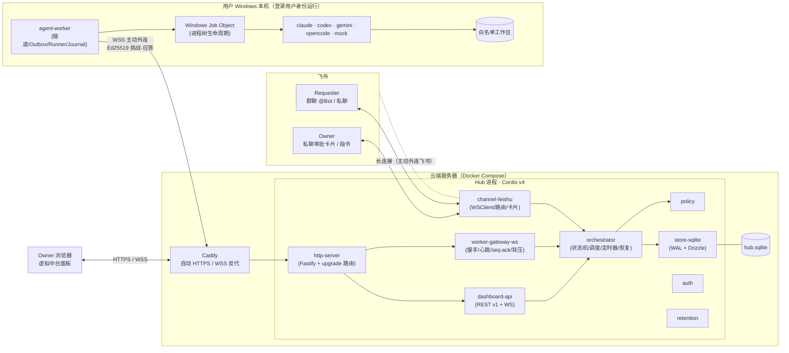
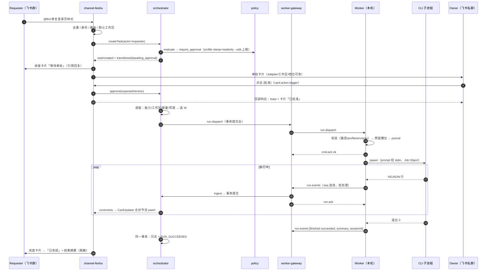
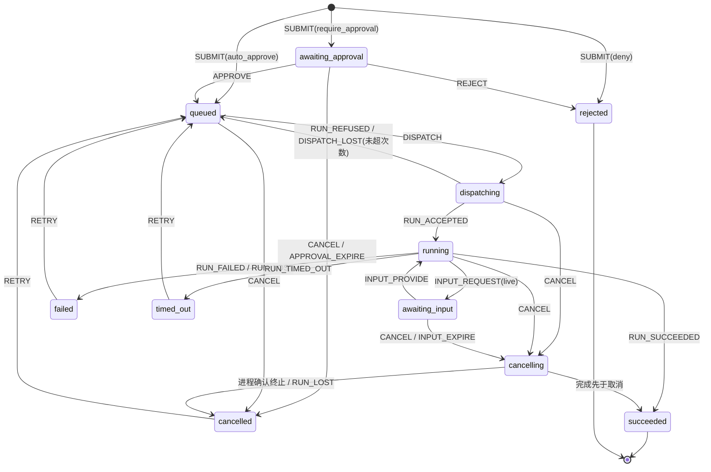

# 飞书对接 × Cordis 云端中台 × 本机常驻 AI CLI 工作流 —— 架构总览

> **文档状态**：v2.1 已冻结（Frozen Baseline · Claude 架构设计 + 主 Agent 独立审查修订 + 用户确认）
> **已确认默认策略**：Requester 为内部可信协作者（默认 `profile: edit` + `require_approval` + `requesterReplyPolicy: auto`，保留 `owner_review` 开关）；首批真实 CLI 适配优先 **`codex`**（保留 `claude-code`/`gemini`/`opencode` 扩展能力及 `mock` 内置适配器）；本机先行单 Worker（保留多 Worker 扩展能力）。
> **工作区**：`E:\Agent工作流`
> **技术基线**：TypeScript (ESM) · pnpm Monorepo · Node ≥ 22.12（推荐 24 LTS）· **`cordis@4.0.0-rc.13`（精确锁定）** · Zod 4 · Fastify 5 + `ws` · better-sqlite3 + Drizzle ORM（SQLite WAL）· `@larksuiteoapi/node-sdk`（WSClient 长连接）· React 18 + Vite
> **本文是总览与索引**；可直接落地的精确规格在 `docs/specs/`，下游交接清单在 `docs/handoff/`。

---

## 0. 文档地图

| 文档 | 内容 | 主要读者 |
| :--- | :--- | :--- |
| **本文** `ARCHITECTURE.md` | 范围、拓扑、关键决策、端到端流程、部署、配置、风险登记 | 全员 / 主 Agent 审查 |
| [`specs/01-hub-cordis-plugins.md`](specs/01-hub-cordis-plugins.md) | Cordis v4 稳定子集、`packages/hub` 目录、服务契约签名、插件依赖图、启动顺序、优雅关闭、热更新、故障隔离 | Codex |
| [`specs/02-task-state-machine.md`](specs/02-task-state-machine.md) | Task/Run/Log 模型、状态与事件、**迁移矩阵**、守卫、定时器、审批策略引擎、多 Worker 调度、不变量 | Codex / Pi |
| [`specs/03-protocol-hub-worker.md`](specs/03-protocol-hub-worker.md) | 反向 WSS 帧 Schema、Ed25519 握手、心跳、seq/ack/resend/gap、背压、命令幂等、宽限期与对账、防暴力 | Codex / Pi |
| [`specs/04-protocol-dashboard.md`](specs/04-protocol-dashboard.md) | 面板鉴权、REST 端点与 DTO、错误码、WS 订阅/续传/日志跟随/慢消费者 | Codex / Pi |
| [`specs/05-feishu-integration.md`](specs/05-feishu-integration.md) | 消息路由、斜杠指令文法、卡片状态机、回调幂等、patch 节流限流 | Codex / Pi |
| [`specs/06-worker-adapters-security.md`](specs/06-worker-adapters-security.md) | `CliAdapter` 接口、各 CLI 命令与解析、Windows 进程树、威胁模型与护栏、`worker.yaml` | Codex / Pi |
| [`specs/07-database-schema.md`](specs/07-database-schema.md) | Drizzle 表定义、索引、日志写入路径、保留清理、迁移 | Codex / Pi |
| [`specs/08-blackboard-harness.md`](specs/08-blackboard-harness.md) | Phase 7：`.board/` 四文件黑板、五子系统 Harness、能力协商、跨 CLI 接力与工作区指针、本地验证引擎 | Codex / Pi |
| [`handoff/codex-implementation-plan.md`](handoff/codex-implementation-plan.md) | 分阶段任务、包边界、技术坑 | Codex |
| [`handoff/pi-test-matrix.md`](handoff/pi-test-matrix.md) | 带 ID 的测试矩阵与阶段门禁 | Pi |
| [`handoff/phase7-implementation-plan.md`](handoff/phase7-implementation-plan.md) | Phase 7a / 7b 文件级实现清单与 Pi 测试矩阵 | Codex / Pi |

---

## 1. 范围

### 1.1 目标（v1）

1. 外部接收方（Requester）在飞书群聊 `@机器人` 或私聊提交需求；Owner（你本人）在飞书或面板审批、干预。
2. 云端 Hub（Cordis 中台）负责接单、审批策略、状态机、调度、审计、日志持久化与回传。
3. 本机常驻 Worker 主动外连 Hub（免公网 IP），在白名单工作区中调用 Claude Code / Codex CLI / Gemini CLI / OpenCode（及测试用 Mock）执行。
4. 虚拟中台面板：全局态势、Worker 拓扑与健康、任务看板、实时流式终端、审批/取消/重试/手动派单。

### 1.2 非目标（v1 明确不做）

| 非目标 | 说明 / 后续 |
| :--- | :--- |
| Hub 多实例 / 高可用 | 单进程 + SQLite；Hub 宕机不影响本机正在执行的任务（见 D-6），但期间不能接新单 |
| 多 Owner / 团队 RBAC | 单 Owner 模型；backlog：飞书 OAuth + 角色 |
| 运行中向 CLI 注入输入（真实 CLI） | 主流 CLI 无头模式不支持；澄清式交互走 Follow-up 子任务 + `--resume`（D-4） |
| 操作系统级沙箱 | CLI 自带权限模式是软边界；建议对外工作区使用独立低权限 Windows 账户运行第二个 Worker（风险 R3） |
| 非文本飞书消息（图片/文件） | backlog |
| 日志全文检索（FTS） | backlog：SQLite FTS5 |

### 1.3 术语

| 术语 | 含义 |
| :--- | :--- |
| Hub | 云端中台进程（`packages/hub`） |
| Worker | 本机常驻守护进程（`packages/worker`），一台机器可运行多个（不同 `workerId`） |
| Adapter | Worker 内对某个 AI CLI 的适配器 |
| Task / Run / Log | 需求 / 一次执行尝试 / Run 的有序事件（02 §1） |
| Owner / Requester | 你本人 / 外部接收方 |
| Profile | 执行权限档位：`readonly` < `edit` < `full` |
| Workspace | Worker 本地配置的白名单目录，以 `workspaceId` 引用 |
| Grace period | Worker 断线后 Hub 保留其 Run 状态的宽限期（默认 90 s） |
| Fiber | Cordis v4 中一个插件实例的生命周期单元 |

---

## 2. 系统拓扑



**两端零入站暴露**：Hub 主动连飞书（长连接），Worker 主动连 Hub（反向 WSS）。Hub 只需对外暴露 443。

---

## 3. 关键架构决策（ADR 摘要）

| ID | 决策 | 理由 | 详见 |
| :--- | :--- | :--- | :--- |
| D-1 | 原生 Cordis v4，**精确锁定 `4.0.0-rc.13`**；所有不稳定 API（`internal/*`、`reflect`、`registry`）收敛在 `hub/src/kernel/`；业务插件只用稳定子集（`Service`、`inject`、`ctx.use`、`ctx.effect`、事件） | Cordis 仍为 RC；把升级影响面限制在一个目录 + 契约测试 K-* | 01 §1–2 |
| D-2 | DSH 三角色：`services/` 只放契约，`plugins/` 放 Provider/Consumer；**依赖图无环**：渠道插件（飞书）是纯 Consumer，Orchestrator 不感知渠道，通过 Cordis 领域事件通知；Worker 网关不注入 Orchestrator，由 Orchestrator 反向注册入站处理器 | 新增渠道零改动核心；Orchestrator 重启时网关保持连接、暂停 ack，Worker 自行缓冲，零丢失 | 01 §4.6、§5 |
| D-3 | Worker 身份用 **Ed25519 密钥对 + 挑战-应答**（一次性 nonce + hubBootId 绑定），一次性注册码 enroll | 私钥不出本机；DB 泄露不致冒用；天然防重放 | 03 §3 |
| D-4 | 多轮对话 = **Follow-up 子任务**（继承 `cliSessionId`、硬亲和原 Worker）；`awaiting_input` 仅用于支持 live 输入的 Adapter（v1 仅 Mock） | 主流 CLI 无头模式不支持运行中输入；终态不可变便于审计；每轮都受审批策略约束 | 02 §1 |
| D-5 | 运行事件流**每 Run 独立 seq、恰好一次有序**：Hub 持久化后累计 ack，Worker 从 `ackSeq+1` 补发；背压丢弃发生在分配 seq **之前**并以 `dropped` 事件计量；无法补发时用 `gap` 区间占位 | 断线/重启都不丢、不重、不乱；大日志不 OOM；序列永远可验证 | 03 §5 |
| D-6 | **Hub 重启 ≠ 取消任务**：Hub 以 4503 关闭 Worker 连接，本机 CLI 继续运行并缓冲；新 Hub 启动后经宽限期对账恢复 | 云端发布/崩溃不影响本机长任务 | 01 §6–7、03 §7 |
| D-7 | **Worker 是本机安全的最终裁决者**：工作区路径、profile 上限、env/args 白名单、adapter 白名单全部由本机 `worker.yaml` 决定，Hub 只能“请求” | Hub 被攻破时把爆炸半径限制在本机配置范围内 | 06 §6 |
| D-8 | Prompt **一律经 stdin** 传入 CLI，禁止 `shell: true`；Windows `.cmd` shim 解析为 `node + cli.js` | 规避命令行长度/转义/注入、prompt 不出现在进程列表、兼容 CVE-2024-27980 修复后的 spawn 行为 | 06 §2、§4.1 |
| D-9 | Windows 进程树用 **Job Object（KILL_ON_JOB_CLOSE）** + `taskkill /T /F` + 启动时 journal 孤儿清理（校验进程创建时间） | 唯一能在 Worker 自身崩溃时也不留孤儿的方案 | 06 §5 |
| D-10 | 同一 `(Worker, 工作区)` 上 `edit/full` 任务**写锁**（同时至多 1 个） | 防止两个 Agent 同时改同一仓库 | 02 §6.3 |
| D-11 | 审批卡片默认发 **Owner 私聊**；外部群里只显示进度卡片；Requester 受众渲染过滤内部信息 | 不向外部暴露工作区/命令/路径 | 05 §6、§9 |
| D-12 | 飞书卡片更新“最新状态胜出”合并 + 每卡最小间隔 + 全局令牌桶 + 429 自适应降速；点击回调直接返回新卡片（不耗 patch 配额） | 不触发频控；卡片失败不影响任务 | 05 §7–8 |
| D-13 | 单一 SQLite 写连接 + 批量 IngestQueue（**事务提交后才 ack**）；日志表 rowid + `UNIQUE(run_id, seq)`；分片删除 + incremental vacuum | 吞吐、幂等、清理不阻塞写入 | 07 |
| D-14 | 所有定时器由 DB 字段可重建，统一 `TimerWheel` + 注入式 `clock` | Hub 重启无状态丢失；测试可用假时钟 | 02 §4 |
| D-15 | Worker 以**登录用户**身份通过计划任务常驻（非 SYSTEM 服务） | CLI 登录凭据在用户目录 | 06 §5.4 |

### 3.1 相对 Draft v1.0 的主要修订

| Draft v1.0 | v2.0 | 原因 |
| :--- | :--- | :--- |
| `ctx.plugin`、事件 `ready` 等 v3 习惯用法 | `ctx.use`、`[Service.init]`、`waitForActive`（基于 Fiber 状态） | 已对照 v4 rc.13 类型声明；`ctx.plugin` 在 v4 已废弃，v4 无 `ready` 事件 |
| `channel-registry` 与 `orchestrator` 相互依赖 | 渠道为纯 Consumer，事件驱动 | 消除依赖环（v4 中 inject 全部为必需依赖，环会导致双方永久 PENDING） |
| `WORKER_SECRET` Bearer 头鉴权 | Ed25519 挑战-应答 | 防重放、DB 泄露不致冒用 |
| 状态：`pending … dispatched` | 删除持久化的 `pending`；新增 `dispatching`（占槽位）、`cancelling`（等待进程确认终止）、`rejected`（区分驳回与取消） | 槽位计数与取消语义必须精确 |
| Worker 环形缓冲最近 2000 条 | 每 Run seq/ack/resend/gap + 三级背压水位 | 2000 条无法保证不丢，也无法防 OOM |
| `claude -p "<prompt>"`（prompt 在 argv） | prompt 经 stdin | 见 D-8 |
| 仅 `taskkill /T /F` | Job Object + taskkill + journal | 见 D-9 |
| `feishu_bindings` 单表 | `feishu_messages`（每条相关消息一行，含角色/受众）+ `feishu_event_dedupe` | 支持引用回复路由与多卡片 |
| pm2 常驻 | 计划任务（登录用户） | 见 D-15 |
| 默认超时 15 min | 默认 30 min + 空闲超时 10 min | AI CLI 长任务常见；空闲超时识别卡死 |

---

## 4. Monorepo 结构

```text
E:\Agent工作流\
├── package.json / pnpm-workspace.yaml / tsconfig.base.json / eslint.config.js / vitest.workspace.ts
├── docs/
│   ├── ARCHITECTURE.md
│   ├── specs/01~07-*.md
│   └── handoff/{codex-implementation-plan.md, pi-test-matrix.md}
├── packages/
│   ├── protocol/      # 纯 Zod Schema + 纯函数（状态机 reducer、指令解析）；只依赖 zod
│   │   ├── src/{common,task,agent-event}.ts
│   │   ├── src/worker/{envelope,handshake,heartbeat,commands,run-events,close-codes}.ts
│   │   ├── src/dashboard/{dto,rest,ws}.ts
│   │   ├── src/feishu/{commands,card-actions}.ts
│   │   └── fixtures/{worker,dashboard,feishu}/{valid,invalid}/*.json
│   ├── common/        # 运行时工具：redact、ulid、clock(System/Fake)、token-bucket、lru、keyed-mutex、backoff、line-splitter
│   ├── hub/           # 云端中台（结构见 01 §3）
│   ├── worker/        # 本机守护（结构见 06 §1）
│   ├── mock-cli/      # 脚本化假 CLI（测试/演示）
│   └── dashboard/     # React 面板
└── deploy/
    ├── docker-compose.yml
    ├── Caddyfile
    ├── hub.example.yaml
    └── windows/install-worker.ps1
```

**依赖边界**（CI 用 dependency-cruiser 校验）：`protocol ← common ← {hub, worker}`；`protocol ← dashboard`；`hub` 与 `worker` 互不依赖。

---

## 5. 端到端流程

### 5.1 外部需求 → 审批 → 执行 → 回传（主流程）



### 5.2 追问续跑

Requester 引用回复结果卡片 → `feishu_messages` 映射到父任务 → `followUp()` 创建子任务（继承 `cliSessionId`、`adapter`、`workspaceId`、`profile`，`required_worker_id=原 Worker`）→ 照常走策略/审批 → Worker 以 `--resume <sessionId>`（或对应 CLI 参数）执行。

### 5.3 断线与恢复

见 03 §7.4 时序图；关键时限：心跳 10 s，suspect 30 s，terminate 45 s，宽限期 90 s。宽限期内重连 → 无缝续传；超过 → Run `lost`，写入型任务默认 `failed(WORKER_LOST)` 不自动重试。

---

## 6. 状态机摘要



完整矩阵、守卫与不变量见 02。

---

## 7. 虚拟中台面板（信息架构）

围绕「一眼看清全局、一点进入现场、一键干预执行」：

1. **全局态势栏**：飞书长连接状态灯、在线 Worker / 槽位占用（`2/4`）、待审批红点、今日成功/失败/成功率/P50 耗时、Hub 状态（draining / 需重启 / 配置错误横幅）、「+ 新建任务」。
2. **Worker 拓扑**：每节点一张卡：主机名、OS、RTT、CPU/内存、槽位进度条、adapter 徽章矩阵（ready/missing/error + 版本）、工作区标签、连接状态（离线时显示宽限期倒计时）、Drain 开关、未确认缓冲与丢弃日志量。
3. **任务流水线**：看板（待审批 / 排队中 / 执行中 / 待输入 / 已完成 / 异常）与表格双视图；卡片显示 `#编号`、来源（群名/人名/面板）、adapter、节点、耗时、最新进展、不可调度原因。
4. **任务现场抽屉**：结构化视图（思考/工具调用/命令/文件改动/回复）与 Raw 终端（xterm）切换；时间线（收单→审批→派发→执行→回传，来自审计）；操作台（批准[可改 adapter/工作区/档位/prompt/指定节点]、驳回、取消、重试、补充输入、继续对话）；多次 Run 切换。
5. **系统页**：策略规则编辑、Worker 注册（生成 enroll 命令）/吊销、API Token、审计查询、插件（Fiber）健康。

数据来源与实时事件映射见 04 §6。

---

## 8. 部署

### 8.1 云端

```yaml
# deploy/docker-compose.yml（示意）
services:
  hub:
    image: agent-hub:latest
    restart: unless-stopped
    stop_grace_period: 20s          # ≥ shutdownTimeoutMs(15s)
    env_file: .env                  # FEISHU_APP_ID / FEISHU_APP_SECRET / HUB_ADMIN_TOKEN_SHA256 / HUB_SESSION_SECRET
    volumes: [ "./data:/data", "./hub.yaml:/app/hub.yaml:ro" ]
    expose: [ "8080" ]
  caddy:
    image: caddy:2
    restart: unless-stopped
    ports: [ "80:80", "443:443" ]
    volumes: [ "./Caddyfile:/etc/caddy/Caddyfile:ro", "caddy_data:/data" ]
volumes: { caddy_data: {} }
```

```caddyfile
hub.example.com {
    encode zstd gzip
    reverse_proxy hub:8080 {
        flush_interval -1
        transport http { read_timeout 0 }   # WebSocket 长连接
    }
}
```

- Hub 必须配置 `server.trustProxy` 为 Caddy 所在网段，才能拿到真实客户端 IP（限速/封禁依赖它）。
- `/data` 为本地卷（禁止 NFS/SMB），每日 `VACUUM INTO` 备份。

### 8.2 本机（Windows）

```powershell
npm i -g @agent-hub/worker            # 或从仓库构建
agent-worker enroll --hub https://hub.example.com --token <面板生成> --id win-desktop
notepad $env:APPDATA\agent-worker\worker.yaml   # 配置工作区与 adapter
agent-worker doctor                   # 检查 Node、CLI 探测、登录状态、Job Object、连通性
agent-worker install-task             # 注册“登录时启动”的计划任务（登录用户身份）
```

### 8.3 飞书开放平台

企业自建应用 → 机器人 → 事件与回调均选「长连接」→ 订阅 `im.message.receive_v1` 与回调 `card.action.trigger` → 开通收发消息与更新卡片权限（名称以控制台为准）→ 私聊机器人 `/whoami` 获取 Owner open_id 写入 `hub.yaml`。

---

## 9. Hub 配置总览（`hub.yaml`）

```yaml
server:
  host: 0.0.0.0
  port: 8080
  publicUrl: https://hub.example.com
  trustProxy: ['172.16.0.0/12']
  timezone: Asia/Shanghai
  shutdownTimeoutMs: 15000
storage:
  path: /data/hub.sqlite
  ingest: { batchMs: 50, batchRows: 500, maxQueueRows: 50000 }
workers:                      # 03
  heartbeatIntervalMs: 10000
  heartbeatTimeoutMs: 30000
  gracePeriodMs: 90000
  handshakeTimeoutMs: 5000
  maxFrameBytes: 1048576
  maxInFlightBytes: 4194304
  ackIntervalMs: 200
  cmdAckTimeoutMs: 10000
  maxResends: 3
orchestrator:                 # 02
  scheduler: { tickMs: 2000, scanLimit: 200, defaultAdapterOrder: [claude-code, codex, gemini, opencode], refuseBackoffMs: 60000 }
  tasks:
    defaultTimeoutMs: 1800000
    idleTimeoutMs: 600000
    approvalTimeoutMs: 86400000
    inputTimeoutMs: 3600000
    cancelAckTimeoutMs: 30000
    maxAttempts: 3
    maxPromptChars: 32000
  limits: { maxActivePerRequester: 2, requesterTasksPerHour: 20 }
logs:                         # 07
  maxBytesPerRun: 20971520
  retentionDays: { succeeded: 30, other: 90 }
  maxDbBytes: 10737418240
dashboard:
  allowedOrigins: [https://hub.example.com]
  sessionTtlMs: 43200000
feishu:                       # 05
  enabled: true
  ownerOpenIds: [ou_xxx]
  requesterPolicy: allowlist   # allowlist | chat
  requesterAllowlist: [ou_yyy]
  allowedChatIds: [oc_zzz]
  approvalTarget: owner_p2p
  requesterReplyPolicy: auto   # auto | owner_review
  defaultWorkspaceId: sandbox
  chatDefaults: { oc_zzz: { workspaceId: sandbox, adapter: claude-code } }
  staleMessageMs: 600000
  card: { minPatchIntervalMs: 3000, minPatchIntervalHighMs: 1000, globalPatchQps: 5, cardMaxBytes: 28672, cardResultMaxChars: 2000 }
```

密钥只来自环境变量：`FEISHU_APP_ID`、`FEISHU_APP_SECRET`、`HUB_ADMIN_TOKEN_SHA256`、`HUB_SESSION_SECRET`。

---

## 10. 风险登记（请主 Agent 重点审查）

| ID | 风险 | 影响 | 当前缓解 | 建议决策 / 待确认 |
| :--- | :--- | :--- | :--- | :--- |
| **R1** | Cordis v4 仍是 RC，API 可能变化；`internal/update`、`internal/status` 为内部事件 | 升级时热更新/就绪判定失效 | 精确锁版本；kernel 适配层；K-* 契约测试 | 接受；升级必须走 K-* 门禁 |
| **R2** | 各 AI CLI 无头模式参数与事件格式快速漂移（尤其 Gemini/OpenCode 的 resume、权限参数） | 解析失败、权限档位失效 | Phase 0 实测夹具；`argsOverride` 配置修正通道；解析降级 | 需在 Phase 0 后更新 06 §4 |
| **R3** | **Prompt 注入**：外部 Requester 可诱导 Agent 读取/外传本机敏感数据；CLI 权限模式不是 OS 沙箱 | 本机数据泄露（最高风险） | 默认审批、Requester 档位上限、工作区隔离、脱敏、`owner_review` | **强烈建议**：对外工作区由独立低权限 Windows 账户上的第二个 Worker 承接；Requester 默认 `readonly`。需用户确认是否接受 `requesterReplyPolicy: auto` 作为默认 |
| **R4** | 飞书频控具体阈值、外部群能力、权限名称以官方为准，本设计采用保守默认值 | 卡片更新被限流或机器人无法入群 | 合并节流 + 自适应降速；Phase 0 Spike 实测 | Phase 0 后修订默认值 |
| **R5** | Job Object 依赖 FFI（`koffi`）原生模块；spawn 与 Assign 间存在微小竞态 | 极端情况下孙进程逃逸 | taskkill 树兜底 + 启动孤儿清理 + 告警 | 接受 |
| **R6** | Hub 单点（单进程 SQLite） | Hub 宕机期间不能接单 | 本机任务不受影响（D-6）；Docker 自动重启；每日备份 | v1 接受 |
| **R7** | 双重执行窗口：ack 丢失 + Worker 断线超过宽限期 → Hub 重新派发，而原 Worker 其实已在执行 | 同一任务执行两次 | `notAfter` 过期拒单；原 Worker 重连后被 `cancel(stale_run)`；写入型任务默认不自动重试，`DISPATCH_LOST` 计入尝试次数 | 接受；在面板中标注“可能重复执行” |
| **R8** | 日志脱敏是尽力而为（未知格式、跨行） | 密钥进入 Hub/飞书 | 双级脱敏 + 已知密钥值精确替换 + Requester 不看原始日志 | 接受 |
| **R9** | Codex 在 Windows 上的沙箱能力有限 | `workspace-write` 隔离强度不足 | 风险告知；同 R3 的独立账户方案 | Phase 0 验证 |
| **R10** | Worker 时钟偏移影响 `notAfter` 判断 | 误拒单或接受过期单 | 握手/心跳估算偏移校正 | 接受 |
| **R11** | 单 Owner 模型 | 无法多人协作审批 | — | backlog |

### 10.1 需用户（或主 Agent）确认的开放问题

1. 云端域名与服务器规格；是否已有反向代理（若已有 Nginx，替换 Caddy 配置）。
2. 接收方是否在**外部群**（影响飞书应用配置）。
3. Requester 默认档位（建议 `readonly`）与是否默认 `owner_review` 结果回传。
4. 是否部署第二个低权限 Worker 专门承接对外任务（R3）。
5. 首批必须支持的 CLI（建议 claude-code + codex 先行，gemini/opencode 随 Phase 3 夹具验证后启用）。

---

## 11. 实施路线（摘要）

| 阶段 | 内容 | 门禁 |
| :--- | :--- | :--- |
| Phase 0 | 脚手架 + 四个 Spike（Cordis 内核契约、CLI 夹具采集、Windows Job Object、飞书长连接） | K-*、WIN 原型 |
| Phase 1 | protocol / common / mock-cli | P-*、SM-1~12 等 |
| Phase 2 | Hub 核心 + Worker 隧道 + Mock 全链路 MVP | GW-*、SC-*、WK-*、E2E-1~8 |
| Phase 3 | 真实 CLI 适配器 + Windows 进程管理 | AD-*、WIN-* |
| Phase 4 | 面板（WS + React） | API-*、DASH-* |
| Phase 5 | 飞书渠道 | FS-*、E2E-11~14 |
| Phase 6 | 保留策略、部署、浸泡测试、运维手册 | PERF-*、SOAK-1 |

详见 `handoff/codex-implementation-plan.md` 与 `handoff/pi-test-matrix.md`。
