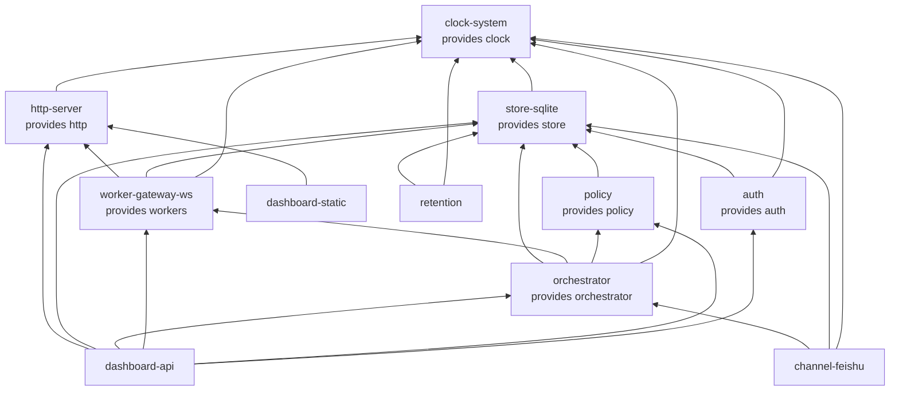

# 01 · Hub：Cordis v4 基座与插件契约

> 对应代码：`packages/hub/`。本文所有 Cordis API 均已对照 **`cordis@4.0.0-rc.13`** 的类型声明核对（`lib/*.d.ts`）。Cordis 仍处于 RC 阶段、API 可能变化，因此**所有对 Cordis 内部/不稳定 API 的调用必须收敛在 `packages/hub/src/kernel/`**，业务插件只使用本文 §2 列出的稳定子集。

---

## 1. 依赖版本锁定

| 依赖 | 版本策略 | 备注 |
| :--- | :--- | :--- |
| `cordis` | **精确锁定** `4.0.0-rc.13`（`"cordis": "4.0.0-rc.13"`，不用 `^`） | 升级需跑完 `kernel` 契约测试（K-*） |
| `zod` | `^4` | Zod 4 实现 Standard Schema，可直接作为 Cordis 插件 `static Config` |
| Node.js | `>= 22.12`（推荐 24 LTS） | ESM、`node:crypto` Ed25519、`AbortSignal.any` |
| TypeScript | `^5.6`，`"module": "NodeNext"`，`"verbatimModuleSyntax": true` | |

## 2. Cordis v4 稳定子集（业务插件允许使用的 API）

| API | 用途 | 说明 |
| :--- | :--- | :--- |
| `class X extends Service` + `super(ctx, 'name')` | 服务提供者（Provider） | 构造函数内即注册服务；`static inject` 声明依赖 |
| `async [Service.init]()` | 异步初始化 | 返回的 Promise 完成后 Fiber 才进入 ACTIVE；依赖方在此之后才会被激活 |
| `static inject = ['a', 'b']` | 显式依赖注入 | **v4 中全部为必需依赖**：任一缺失 → Fiber 保持 PENDING |
| `static Config = zodSchema` | 配置校验 | 失败抛 `ValidationError`，Fiber 进入 FAILED |
| `ctx.use(plugin, config)` | 加载子插件 | 返回 `Fiber & PromiseLike<Fiber>`；`ctx.plugin` 已废弃，**禁止使用** |
| `ctx.inject(['x'], (ctx) => {...})` | 可选依赖子作用域 | 用于“有则启用”的功能（如 feishu 存在时才注册某些监听） |
| `ctx.effect(fn, label)` | 可逆副作用 | `fn` 返回 disposer / Promise<disposer> / 同步或异步生成器（每个 `yield` 一个 disposer）；Fiber 卸载时 **LIFO** 执行 |
| `ctx.on(name, listener)` / `ctx.emit` / `ctx.parallel` / `ctx.serial` | 事件总线 | 监听器自动绑定当前 Fiber，卸载时自动移除 |
| `ctx.logger(name)` | 日志 | 返回 `Logger`（`info/warn/error/debug`）；日志消息携带 `fiber` 弱引用，可归因到插件 |
| `fiber.update(config)` / `fiber.restart()` / `fiber.dispose()` / `fiber.state` | 生命周期控制 | 仅 `kernel/` 与 `config-watcher` 使用 |

**仅允许在 `kernel/` 内使用**（不稳定/内部）：`ctx.on('internal/update', …)`（热更新拦截）、`ctx.on('internal/status', …)`（Fiber 状态观测）、`ctx.reflect.*`、`ctx.registry.*`。

> ⚠️ 坑：`FiberState` / `LoggerLevel` 在 `.d.ts` 中是 `const enum`，在 `isolatedModules`/`verbatimModuleSyntax` 下无法跨包内联。`kernel/fiber-state.ts` 中自行定义镜像常量：`PENDING=0, LOADING=1, ACTIVE=2, FAILED=3, DISPOSED=4, UNLOADING=5`，并由契约测试 K-1 断言与运行时一致。

---

## 3. 目录结构

```text
packages/hub/
├── package.json                       # "type": "module", bin: agent-hub
├── tsconfig.json
├── drizzle.config.ts
├── migrations/                        # drizzle-kit 生成的 SQL 迁移（提交入库）
└── src/
    ├── main.ts                        # 进程入口：加载配置 → 创建 root Context → use(HubApp) → 信号处理
    ├── app.ts                         # HubApp 组合插件：唯一的“应用级 Fiber”，dispose 即全量关闭
    ├── config/
    │   ├── schema.ts                  # HubConfig（Zod），按插件分段
    │   ├── load.ts                    # YAML + 环境变量合并（密钥只从 env 读）
    │   └── watcher.ts                 # 文件监听 → 分段 diff → fiber.update()
    ├── kernel/                        # Cordis 适配层（唯一允许触碰 internal API 的目录）
    │   ├── events.ts                  # declare module 'cordis' { interface Events / Context }
    │   ├── fiber-state.ts             # FiberState 镜像常量
    │   ├── lifecycle.ts               # waitForActive()、critical 插件监控、关闭编排
    │   ├── hot-update.ts              # onHotUpdate(ctx, hotKeys, apply)：封装 internal/update
    │   ├── safe.ts                    # safeOn()：监听器异常隔离；guardAsync()
    │   └── supervisor.ts              # 非关键插件 FAILED 后的退避重启
    ├── services/                      # DSH Role 1：服务契约（只有类型/抽象类，无实现）
    │   ├── clock.ts
    │   ├── http.ts
    │   ├── store.ts
    │   ├── policy.ts
    │   ├── auth.ts
    │   ├── workers.ts
    │   └── orchestrator.ts
    ├── plugins/                       # DSH Role 2 (Provider) & Role 3 (Consumer)
    │   ├── clock-system/              # provides clock
    │   ├── http-server/               # provides http（Fastify 5 + 原生 upgrade 路由）
    │   ├── store-sqlite/              # provides store（better-sqlite3 + drizzle）
    │   │   ├── index.ts
    │   │   ├── schema.ts              # drizzle 表定义（见 07）
    │   │   ├── repos/*.ts             # tasks / runs / logs / workers / feishu / audit / ...
    │   │   └── ingest-queue.ts        # 日志批量写入队列
    │   ├── policy/                    # provides policy
    │   ├── auth/                      # provides auth（面板会话、API Token、enroll token）
    │   ├── worker-gateway-ws/         # provides workers
    │   │   ├── index.ts
    │   │   ├── handshake.ts
    │   │   ├── connection.ts          # 单连接状态机、心跳、入站限速
    │   │   ├── command-outbox.ts
    │   │   ├── run-inbox.ts           # seq 校验、缺口检测、ack 合并
    │   │   └── rate-limit.ts
    │   ├── orchestrator/              # provides orchestrator（Consumer of store/workers/policy/clock）
    │   │   ├── index.ts
    │   │   ├── state-machine.ts       # 持久化执行器（reducer 在 protocol 包）
    │   │   ├── scheduler.ts
    │   │   ├── timers.ts              # TimerWheel
    │   │   ├── recovery.ts            # 启动对账
    │   │   └── keyed-mutex.ts
    │   ├── dashboard-api/             # Consumer：REST + /ws/dashboard
    │   │   ├── routes/*.ts
    │   │   ├── ws-hub.ts              # 订阅管理、事件序号、慢消费者处理
    │   │   └── log-follow.ts          # 追赶 + 实时拼接
    │   ├── dashboard-static/          # Consumer：托管 dashboard 构建产物
    │   ├── channel-feishu/            # Consumer：飞书（见 05）
    │   │   ├── index.ts
    │   │   ├── transport.ts           # FeishuTransport 接口 + SDK 实现（测试可替换）
    │   │   ├── router.ts              # 消息路由 / 斜杠指令解析
    │   │   ├── cards/*.ts             # 卡片模板（纯函数：state → Card JSON 2.0）
    │   │   ├── card-updater.ts        # 节流/合并/限流
    │   │   └── action-handler.ts      # card.action.trigger 处理 + 幂等锁
    │   └── retention/                 # Consumer：日志清理、WAL checkpoint、去重表过期
    └── util/                          # 与 Cordis 无关的纯工具（ULID、令牌桶、LRU…，可移入 @agent-hub/common）
```

---

## 4. 服务契约（DSH Role 1）

服务名即 Context 属性名，统一在 `kernel/events.ts` 中声明：

```ts
// packages/hub/src/kernel/events.ts
import type { Clock } from '../services/clock.js'
import type { HttpService } from '../services/http.js'
import type { TaskStore } from '../services/store.js'
import type { PolicyService } from '../services/policy.js'
import type { AuthService } from '../services/auth.js'
import type { WorkerGateway } from '../services/workers.js'
import type { Orchestrator } from '../services/orchestrator.js'
import type { TaskView, RunView, WorkerView, TaskTransition, RunEvent, HubSystemStatus } from '@agent-hub/protocol'

declare module 'cordis' {
  interface Context {
    clock: Clock
    http: HttpService
    store: TaskStore
    policy: PolicyService
    auth: AuthService
    workers: WorkerGateway
    orchestrator: Orchestrator
  }

  interface Events {
    // —— 领域事件：全部在 DB 事务提交之后发布（“已持久化”语义）——
    'task/created'(task: TaskView): void
    'task/transitioned'(t: TaskTransition): void        // { task, from, to, event, actor, runId?, reason? }
    'run/updated'(run: RunView): void
    'run/events'(runId: string, taskId: string, events: RunEvent[]): void  // 已持久化的事件批
    'worker/updated'(worker: WorkerView, prev: WorkerView | null): void
    'worker/connected'(workerId: string, epoch: number): void
    'worker/disconnected'(workerId: string, reason: string): void
    // —— 系统事件 ——
    'hub/status'(status: HubSystemStatus): void          // feishu 连接状态、draining、配置错误
    'hub/drain'(): Promise<void>                          // 关闭前“停止接收新工作”阶段（ctx.parallel 调用）
    'hub/config-rejected'(section: string, error: string): void
  }
}
```

### 4.1 `clock`

```ts
export interface Clock {
  now(): number                                   // epoch ms
  monotonic(): number                             // performance.now()
  setInterval(fn: () => void, ms: number): () => void   // 返回 disposer，调用方必须放进 ctx.effect
}
```
测试中由 `FakeClock` 提供（`advance(ms)`），这是所有定时逻辑可测的前提。

### 4.2 `http`

```ts
export interface HttpService {
  readonly app: FastifyInstance                    // 仅用于注册路由
  /** 注册 WebSocket 升级路由；返回 disposer。路径冲突抛错。 */
  upgrade(path: string, handler: UpgradeHandler): () => void
  /** 就绪状态：false 时 /readyz 返回 503，且新请求返回 503 HUB_SHUTTING_DOWN（除 GET 只读接口） */
  setAccepting(accepting: boolean): void
}
export type UpgradeHandler = (req: IncomingMessage, socket: Duplex, head: Buffer) => void
```
- 使用 Fastify 5 + `ws`（`noServer: true`），由 `http-server` 统一监听 `server.on('upgrade')` 并按路径分发——避免两个 `WebSocketServer` 同时挂 upgrade 事件导致的竞争。
- **路由注册与热重载（重要）**：Fastify 在 `listen()` 之后不允许再调用 `app.get()/post()`。为同时满足“启动延迟监听”与“消费插件（如 `dashboard-api`）在 Provider 重启级联（K-10）后可重新挂载路由”，`http-server` 对 `/api/*` 与 `/healthz|/readyz` 预注册通配转发入口，内部委托给一个可撤销、可替换的子路由器（如 `find-my-way` 或 `Hono`），DTO 校验统一由路由器中间件直接调用 `@agent-hub/protocol` 的 Zod Schema 完成（不依赖 Fastify 静态路由级 type-provider），disposer 执行时移除对应路由表项。即：**插件注册的是可撤销的 handler 表，而非静态 Fastify 路由**。

### 4.3 `store`

```ts
export interface TaskStore {
  /** 同步事务（better-sqlite3 同步 API）；回调内禁止 await */
  tx<T>(fn: (repos: Repos) => T): T
  readonly repos: Repos                            // 非事务读
  readonly ingest: LogIngestQueue
  health(): { ok: boolean; walSizeBytes: number; dbSizeBytes: number }
}

export interface Repos {
  tasks: TaskRepo; runs: RunRepo; logs: LogRepo; workers: WorkerRepo
  feishu: FeishuRepo; audit: AuditRepo; inputs: InputRequestRepo
  policies: PolicyRepo; idempotency: IdempotencyRepo; enroll: EnrollTokenRepo; sessions: SessionRepo
}

export interface TaskRepo {
  get(id: string): TaskRow | undefined
  getByNo(taskNo: number): TaskRow | undefined
  insert(row: NewTaskRow): TaskRow                 // task_no 由 meta 计数器分配
  casUpdate(id: string, expectedVersion: number, patch: Partial<TaskRow>): boolean
  listQueued(limit: number): TaskRow[]
  listActive(): TaskRow[]
  search(q: TaskQuery): { items: TaskRow[]; nextCursor?: string }
}

export interface LogIngestQueue {
  /** 入队已通过 seq 校验的事件；Promise 在所属事务提交后 resolve（用于决定何时 ack） */
  enqueue(runId: string, events: RunEvent[]): Promise<{ lastSeq: number }>
  flush(): Promise<void>                           // 关闭时调用
}
```
（其余 Repo 签名与 07 表结构一一对应，Codex 按表补齐 CRUD；任何跨表写入必须在 `tx()` 内。）

### 4.4 `policy`

```ts
export interface PolicyService {
  evaluate(input: PolicyInput): PolicyDecision    // 纯同步、确定性
  listRules(): PolicyRule[]
  replaceRules(rules: PolicyRule[], actor: Actor): void   // 校验 + 落库 + 原地刷新缓存
}
```

### 4.5 `auth`

```ts
export interface AuthService {
  login(adminToken: string, meta: ReqMeta): { sessionId: string; csrfToken: string; expiresAt: number }
  verifySession(cookie: string | undefined): Principal | null
  verifyApiToken(bearer: string | undefined): Principal | null
  logout(sessionId: string): void
  createEnrollToken(actor: Actor): { token: string; expiresAt: number }
  consumeEnrollToken(token: string): boolean
}
```

### 4.6 `workers`（Worker 网关，见 03）

```ts
export interface WorkerGateway {
  list(): WorkerView[]
  get(workerId: string): WorkerView | undefined
  isOnline(workerId: string): boolean
  /** 入队命令（至少一次投递）。Promise 在收到 cmd.ack 时 resolve；超时/超出重发上限 reject(CommandTimeoutError) */
  send<T extends HubCommand>(workerId: string, cmd: T): Promise<CmdAckPayload>
  setDrain(workerId: string, drain: boolean, actor: Actor): Promise<void>
  revoke(workerId: string, actor: Actor): Promise<void>
  /**
   * orchestrator 注册入站处理器（仅允许一个）。返回 disposer，必须放入 ctx.effect。
   * 未注册处理器期间：网关不 ack 任何 run.events（Worker 自行缓冲），hello 对账延迟到处理器注册后。
   */
  setInboundHandler(handler: WorkerInboundHandler): () => void
}

export interface WorkerInboundHandler {
  /** 返回 Promise 在事件持久化后 resolve；网关据此发送 run.ack */
  onRunEvents(workerId: string, frame: RunEventsFrame): Promise<{ ackSeq: number }>
  onRunGap(workerId: string, frame: RunGapFrame): Promise<{ ackSeq: number }>
  onCommandAck(workerId: string, cmd: HubCommand, ack: CmdAckPayload): void
  /** hello 鉴权通过后调用，返回 resume 指令（见 03 §7.2） */
  reconcile(workerId: string, hello: WorkerHelloPayload): Promise<ResumeDirective[]>
  onWorkerOffline(workerId: string, at: number): void
}
```

**设计决策（D-HUB-1）**：网关不注入 orchestrator（避免循环依赖），而是由 orchestrator 反向注册处理器。好处：orchestrator 重启期间网关保持所有 Worker 连接，只是暂停 ack——Worker 自行缓冲，零数据丢失。

### 4.7 `orchestrator`（业务编排门面）

```ts
export interface Orchestrator {
  createTask(input: CreateTaskInput, actor: Actor, opts?: { idempotencyKey?: string }): Promise<TaskView>
  approve(taskId: string, actor: Actor, opts?: { expectedVersion?: number; overrides?: ApprovalOverrides }): Promise<TaskView>
  reject(taskId: string, actor: Actor, opts?: { expectedVersion?: number; reason?: string }): Promise<TaskView>
  cancel(taskId: string, actor: Actor, opts?: { reason?: string }): Promise<TaskView>
  retry(taskId: string, actor: Actor, opts?: { overrides?: ApprovalOverrides }): Promise<TaskView>
  provideInput(taskId: string, actor: Actor, input: { requestId: string; answer: string }): Promise<TaskView>
  followUp(parentTaskId: string, actor: Actor, input: { prompt: string; origin: TaskOrigin }): Promise<TaskView>
  getTask(taskId: string): TaskDetailView | undefined
  overview(): OverviewView
  /** 关闭阶段：停止调度，不再发 dispatch */
  pauseScheduling(): void
}
```
错误统一抛 `HubError(code, httpStatus, details)`（错误码表见 04 §2.3），消费方（REST/飞书）负责翻译成各自的表现形式。

---

## 5. 插件清单与依赖图

| 插件 | 角色 | `static inject` | provides | 关键 | 热更新键（in-place） | 冷键（需重启该 Fiber） |
| :--- | :--- | :--- | :--- | :---: | :--- | :--- |
| `clock-system` | Provider | — | `clock` | ✅ | — | — |
| `http-server` | Provider | `clock` | `http` | ✅ | `trustProxy`, `corsOrigins` | `host`, `port`（**仅进程重启**） |
| `store-sqlite` | Provider | `clock` | `store` | ✅ | `ingest.batchMs`, `ingest.batchRows` | `path`（**仅进程重启**） |
| `policy` | Provider | `store` | `policy` | ✅ | （规则在 DB，API 热更新） | — |
| `auth` | Provider | `store`, `clock` | `auth` | ✅ | `sessionTtlMs`, `loginRateLimit` | `adminTokenHash`（Fiber 重启，会话保留） |
| `worker-gateway-ws` | Provider | `http`, `store`, `clock` | `workers` | ✅ | `heartbeat*`, `gracePeriodMs`, `rateLimits`, `redactionPatterns` | `path`（**仅进程重启**） |
| `orchestrator` | Provider + Consumer | `store`, `workers`, `policy`, `clock` | `orchestrator` | ✅ | `scheduler.*`, `tasks.*Timeout*`, `maxAttempts` | — |
| `dashboard-api` | Consumer | `http`, `store`, `orchestrator`, `workers`, `policy`, `auth` | — | ✅ | `wsLimits` | — |
| `dashboard-static` | Consumer | `http` | — | ❌ | — | `distDir` |
| `channel-feishu` | Consumer | `orchestrator`, `store`, `clock` | `feishu`（状态只读） | ❌ | `card.*`, `ownerOpenIds`, `requesterAllowlist`, `allowedChatIds`, 文案 | `appId`, `appSecret`, `domain` |
| `retention` | Consumer | `store`, `clock` | — | ❌ | 全部 | — |



**无环约束**：任何插件都不得注入其消费者。Consumer 之间（dashboard-api 与 channel-feishu）只通过 Cordis 事件和 `orchestrator` 门面间接交互。新增渠道（钉钉/Slack）= 新增一个 `channel-*` Consumer 插件，零改动核心。

### 5.1 启动顺序（由 inject 自动推导）

```text
L0: clock-system
L1: http-server, store-sqlite              (store 运行迁移 + PRAGMA 后才 ACTIVE)
L2: policy, auth, worker-gateway-ws        (gateway 注册 upgrade 路由，但在处理器注册前不 ack)
L3: orchestrator                           (init 中执行 recovery：见 §7)
L4: dashboard-api, dashboard-static, channel-feishu, retention
L5: kernel/lifecycle → http.listen() → 状态 ready
```

`main.ts` 伪代码：

```ts
const config = await loadConfig()                 // 失败直接 exit(78)
const root = new Context()
installLogExporter(root, config.logging)          // ctx.logger.exporter(...) → JSON 行输出到 stdout
const appFiber = root.use(HubApp, config)
const ok = await waitForActive(appFiber.ctx, CRITICAL_PLUGINS, { timeoutMs: 30_000 })
if (!ok.success) { log.error('startup failed', ok.failed); await shutdown(1) }
await root.get('http')!.listen()
installSignalHandlers(shutdown)                    // SIGINT, SIGTERM, SIGBREAK(win32)
watchConfig(appFiber, config)                      // 热更新
```

`waitForActive` 实现要点：Fiber 在依赖缺失时停留 PENDING 且 `await()` 会立即返回，因此不能只 `await fiber`；必须监听 `internal/status` 直到所有关键 Fiber 为 ACTIVE，或任一为 FAILED，或超时。

### 5.2 Provider 模板

```ts
// packages/hub/src/plugins/worker-gateway-ws/index.ts
import { Context, Service } from 'cordis'
import { z } from 'zod'
import { onHotUpdate } from '../../kernel/hot-update.js'
import type { WorkerGateway } from '../../services/workers.js'

export const WorkerGatewayConfig = z.object({
  path: z.string().default('/ws/worker'),
  heartbeatIntervalMs: z.number().int().default(10_000),
  heartbeatTimeoutMs: z.number().int().default(30_000),
  gracePeriodMs: z.number().int().default(90_000),
  handshakeTimeoutMs: z.number().int().default(5_000),
  maxFrameBytes: z.number().int().default(1 << 20),
  maxInFlightBytes: z.number().int().default(4 << 20),
  ackIntervalMs: z.number().int().default(200),
  cmdAckTimeoutMs: z.number().int().default(10_000),
  maxResends: z.number().int().default(3),
  redactionPatterns: z.array(z.string()).max(64).default([]),
  rateLimits: z.object({ /* 见 03 §8 */ }).default({}),
})
export type WorkerGatewayConfig = z.infer<typeof WorkerGatewayConfig>

export default class WorkerGatewayWs extends Service implements WorkerGateway {
  static inject = ['http', 'store', 'clock']
  static Config = WorkerGatewayConfig

  private conns = new Map<string, WorkerConnection>()

  constructor(ctx: Context, private config: WorkerGatewayConfig) {
    super(ctx, 'workers')
  }

  async [Service.init]() {
    const log = this.ctx.logger('workers')
    // 1) WS 服务器与升级路由：两个 disposer，LIFO 释放
    this.ctx.effect(function* (this: WorkerGatewayWs) {
      const wss = new WebSocketServer({ noServer: true, maxPayload: this.config.maxFrameBytes, perMessageDeflate: false })
      yield () => new Promise<void>((resolve) => wss.close(() => resolve()))
      yield this.ctx.http.upgrade(this.config.path, (req, socket, head) => this.onUpgrade(wss, req, socket, head))
    }.bind(this), 'workers:wss')

    // 2) 健康巡检定时器
    this.ctx.effect(() => this.ctx.clock.setInterval(() => this.sweep(), 1_000), 'workers:sweep')

    // 3) 关闭：通知所有 Worker “Hub 重启中”，不取消任何本机任务
    this.ctx.effect(() => async () => {
      await Promise.allSettled([...this.conns.values()].map((c) => c.close(4503, 'hub shutting down')))
    }, 'workers:close-all')

    // 4) 热更新：仅心跳/宽限期/限速参数原地生效；其余键 next() → Fiber 重启
    onHotUpdate(this.ctx, ['heartbeatIntervalMs', 'heartbeatTimeoutMs', 'gracePeriodMs', 'rateLimits', 'ackIntervalMs'],
      (next) => { this.config = next; log.info('hot config applied') })

    // 5) 从 DB 恢复 Worker 注册表（连接状态一律置 offline）
    this.ctx.store.tx((r) => r.workers.markAllOffline(this.ctx.clock.now()))
  }

  // ... list/get/send/setDrain/revoke/setInboundHandler 实现
}
```

### 5.3 Consumer 模板（无需提供服务的插件用函数式）

```ts
// packages/hub/src/plugins/retention/index.ts
export const name = 'retention'
export const inject = ['store', 'clock']
export const Config = RetentionConfig
export function apply(ctx: Context, config: RetentionConfig) {
  ctx.effect(() => ctx.clock.setInterval(() => runRetentionSlice(ctx, config), config.sliceIntervalMs), 'retention:tick')
}
```

### 5.4 `kernel/hot-update.ts`

```ts
/**
 * 拦截 fiber.update(config)：
 *  - 若新旧配置的差异仅落在 hotKeys 内 → 调用 apply(newConfig)，不重启 Fiber
 *  - 否则调用 next() → Cordis 默认行为：Fiber 重启（dispose 全部 effect 后重新执行 init）
 * 唯一使用 internal/update 的地方。
 */
export function onHotUpdate<C extends object>(ctx: Context, hotKeys: (keyof C)[], apply: (config: C) => void): void
```

---

## 6. 优雅关闭（Graceful Shutdown）

触发：`SIGINT` / `SIGTERM` / Windows `SIGBREAK` / 关键插件运行期 FAILED / `uncaughtException`。同一时刻只执行一次（`shuttingDown` 标志），第二次信号 → 立即 `process.exit(130)`。

| 阶段 | 动作 | 超时 |
| :--- | :--- | :--- |
| **P1 停止接收** | `http.setAccepting(false)`（/readyz → 503）；`await root.parallel('hub/drain')`：orchestrator `pauseScheduling()`；feishu 对新消息回复“系统维护中，请稍后重试”；dashboard-api 广播 `system.status{draining:true}` | 3 s |
| **P2 冲刷** | feishu `CardUpdater.flush()`（尽力推送最终卡片）；`store.ingest.flush()` | 5 s |
| **P3 拆除** | `await appFiber.dispose()` —— Cordis 按依赖**逆序**卸载（Consumer → orchestrator → workers → store → http → clock），每个 Fiber 内部 effect 按 LIFO 执行。workers 卸载时以 **4503** 关闭所有 Worker 连接（本机 CLI 继续运行，Worker 缓冲事件并重连新 Hub） | 剩余预算 |
| **P4 收尾** | store disposer：`PRAGMA wal_checkpoint(TRUNCATE)` → `db.close()`；http disposer：`server.close()` + `closeAllConnections()` | — |
| 兜底 | 总预算 `shutdownTimeoutMs = 15 s`，超时 `process.exit(1)`（状态全部可由 DB 恢复，强退安全） | |

**关键语义（D-HUB-2）**：Hub 重启 ≠ 取消任务。Run 状态全部保留在 DB，Worker 侧进程不受影响；新 Hub 启动后经宽限期对账恢复（03 §7）。

> 依赖逆序卸载的依据：`Fiber._unload()` 会等待自身提供的服务的所有依赖方（`impl.dependents`）先释放，再执行自身的 disposers。K-4 契约测试需验证此行为。

## 7. 启动恢复（orchestrator `recovery.ts`）

在 `orchestrator[Service.init]` 中、注册入站处理器**之前**执行：

1. 所有 Worker 连接状态已由网关置 `offline`；对每个拥有非终态 Run 的 Worker，以 `max(disconnected_at, hubStartAt)` 为起点启动宽限期计时。
2. 重建 TimerWheel：审批超时、输入超时、运行兜底。
3. 重建命令 Outbox：`dispatching` → `run.dispatch`（若 `notAfter` 已过则直接 `DISPATCH_LOST`）；`cancelling` → `run.cancel`；已回答未投递的输入 → `run.input`。
4. 注册入站处理器 → 网关开始处理排队中的 hello（对账）。
5. 触发一次调度。

## 8. 插件故障隔离

| 场景 | 机制 | 结果 |
| :--- | :--- | :--- |
| 插件 `apply`/`init` 抛错 | Cordis 捕获，Fiber → FAILED，不影响兄弟 Fiber；依赖它的 Fiber 保持 PENDING | 启动期：关键插件 FAILED → 退出码 1（交给 Docker `restart: unless-stopped`）；非关键插件 FAILED → `supervisor` 以 5s→10s→…→5min 退避调用 `fiber.restart()`，面板 `system.status` 显示 degraded |
| 运行期事件监听器同步抛错 | `kernel/safe.ts` 的 `safeOn()` 包装：try/catch + 按插件计数；**所有业务插件必须用 `safeOn` 而非裸 `ctx.on`**（Lint 规则禁止） | 单个监听器失败不影响事件的其他监听器与发布者 |
| 异步任务 rejected | `guardAsync(ctx, promise, label)`：捕获并记录到所属 Fiber 的 logger | 不触发 `unhandledRejection` |
| 第三方 SDK 抛出未捕获异常（如 ws error 无监听） | `process.on('uncaughtException')`：记录 → 若栈归因于非关键插件，`fiber.restart()` 该插件；否则执行优雅关闭并退出 1 | 状态可从 DB 恢复 |
| 事件监听器慢 | 监听器内禁止阻塞：重活一律投递到插件自有的有界队列（feishu CardUpdater、dashboard 广播队列、IngestQueue） | 发布方（状态机）永不被消费者拖慢 |
| 队列溢出 | 每个队列有上限与溢出策略（合并/丢弃最旧/降级为 resync），并暴露指标 | 内存有界 |
| Provider 重启引发级联 | Cordis 语义：Provider 重启 → 所有依赖方重启。因此 `store`/`http`/`workers` 不做冷热更新（其冷键只能进程重启），且所有 Consumer 的内存状态必须可从 DB 重建 | 可预期 |

## 9. 配置热更新

```text
hub.yaml 变化 ─► watcher（fs.watch + 500ms 防抖）─► 读取 + Zod 校验
   ├─ 校验失败：保留旧配置，emit hub/config-rejected，面板横幅提示，日志 ERROR
   └─ 校验通过：按插件分段做深比较
        ├─ 段落无变化：跳过
        ├─ 段落含“仅进程重启”键：不应用，面板提示 restartRequired
        └─ 否则：fiber.update(newSection)
              ├─ 仅热键变化 → onHotUpdate 原地应用
              └─ 含冷键 → 该 Fiber（及其依赖方）重启
```

- 密钥（`FEISHU_APP_SECRET`、`HUB_ADMIN_TOKEN_SHA256`、`HUB_SESSION_SECRET` 等）**只从环境变量读取**，不参与热更新（修改需重启进程）。
- 每次配置应用写审计 `config.applied { section, keys }`（不含值）。
- 面板 `PUT /api/v1/config/policies` 修改的是 DB 中的策略规则，不经过文件。

## 10. 可观测性

- 日志：Cordis `ctx.logger(name)` → 自定义 exporter 输出 JSON Lines（`ts, level, name, fiber, msg, ...`），统一经过脱敏器（与 Worker 共享 `@agent-hub/common/redact`）。
- 指标（v1 以 `GET /api/v1/system/metrics` JSON 暴露，backlog 再接 Prometheus）：在线 Worker、队列长度、各状态任务数、ingest 队列深度与批延迟、飞书 patch 速率与 429 次数、各 Fiber 状态、WS 连接数、丢弃日志字节。

## 11. Phase 7 增量（Blackboard & Harness，权威规格见 [08](08-blackboard-harness.md)）

- **不新增插件、不新增服务、依赖图不变**：Harness 逻辑落在 `orchestrator`（`plugins/orchestrator/{harness,pointers}.ts`）、`worker-gateway-ws`（能力协商）、`dashboard-api`（新路由）与 `channel-feishu`（指令/卡片）内。
- 服务契约增量：`WorkerGateway.capabilities(workerId)`；`Orchestrator.handoff / handoffPreview / runHarness / listWorkspacePointers / acceptRun`（08 §8.10）。
- 新领域事件（`kernel/events.ts`）：`'workspace/pointer'(view: WorkspacePointerView): void`，与其他领域事件一样在事务提交后发布（08 §8.9）。
- 配置：`hub.yaml` 新增 `harness` 段（经 `orchestratorConfig()` 注入 orchestrator，热键 `harness`）与 `workers.capabilities`（网关热键，仅影响新连接）（08 §8.1）。
