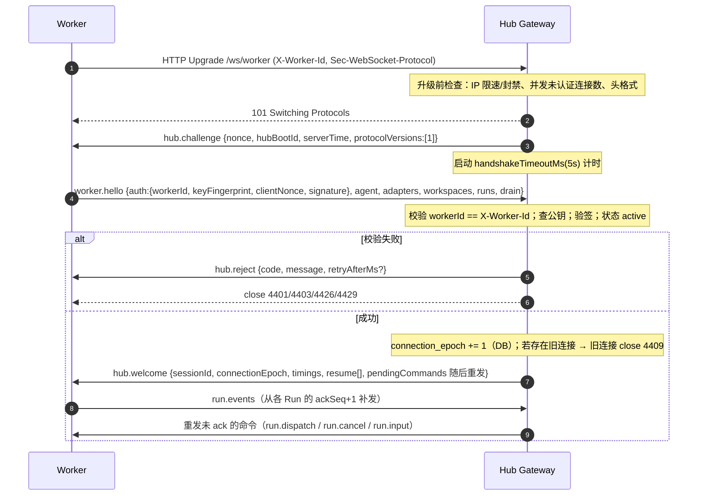
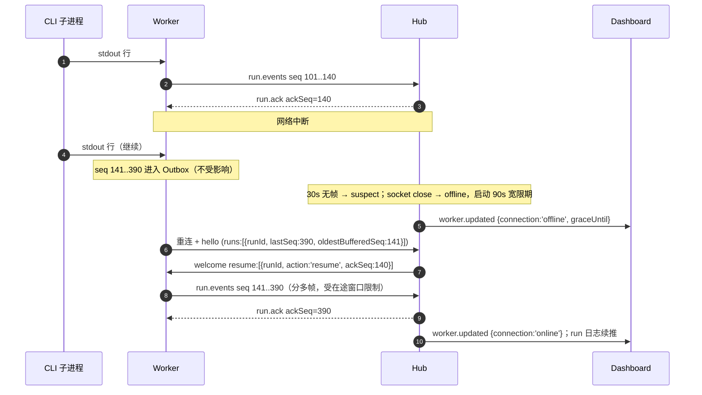

# 03 · Hub ↔ Worker 反向 WSS 协议规格（v1）

> 对应代码：`packages/protocol/src/worker/*.ts`（Zod Schema）、`packages/hub/src/plugins/worker-gateway-ws/`、`packages/worker/src/tunnel/`。
> 本协议是**可靠、有序、可恢复**的应用层协议，建立在单条 WebSocket（TLS）之上。WebSocket 本身只保证单连接内有序，跨断线的可靠性由本协议的 `seq` / `ack` / `resume` 机制提供。

---

## 1. 连接与传输层

| 项 | 规定 |
| :--- | :--- |
| 端点 | `wss://<hub-domain>/ws/worker` |
| 子协议 | `Sec-WebSocket-Protocol: agent-hub.worker.v1`（Hub 不支持则以 4426 关闭） |
| TLS | 生产必须 TLS（由 Caddy 终止，TLS 1.2+，推荐 1.3）；Hub 仅在 `server.allowInsecureWorker=true`（仅开发）时接受 `ws://` |
| 编码 | 每个 WS 文本消息 = 1 个 UTF-8 JSON 帧；禁止二进制帧（收到 → 4400） |
| 帧大小 | `ws` 服务端 `maxPayload` 统一设为 `maxFrameBytes`（默认 1 MiB，超限 → 1009）；鉴权前在 `message` 处理器内额外强制字节长度 ≤ 16 KiB（超限 → 4400） |
| 升级前检查 | 路径、子协议、`X-Worker-Id` 头格式（`^[a-z0-9][a-z0-9-]{1,62}$`）、IP 速率限制（§8）在 `server.on('upgrade')` 中完成，失败直接写 HTTP 4xx 并销毁 socket，不进入 WS |
| 压缩 | 关闭 `permessage-deflate`（防 CPU/内存放大攻击；日志已在应用层批处理） |

### 1.1 关闭码

| Code | 名称 | Worker 行为 |
| :--- | :--- | :--- |
| 1000 | 正常关闭 | 不重连（仅 Worker 主动退出时使用） |
| 1001 | Going away | 退避重连 |
| 1009 | 帧过大 | 记录错误，退避重连（Bug 级问题，需告警） |
| 4400 | `BAD_FRAME` 帧非法/Schema 校验失败 | 退避重连 |
| 4401 | `AUTH_FAILED` 签名错误/未注册 | **长退避**（5 min），本地日志 FATAL 提示重新 enroll |
| 4403 | `WORKER_REVOKED` 已吊销/禁用 | 停止重连，进程以非 0 退出 |
| 4408 | `TIMEOUT` 握手或心跳超时 | 退避重连 |
| 4409 | `SUPERSEDED` 同一 workerId 有新连接 | 若本进程仍认为自己是活跃实例：长退避；用于检测“同一身份两处运行” |
| 4426 | `UNSUPPORTED_VERSION` | 停止重连，提示升级 |
| 4429 | `RATE_LIMITED` | 按 `retryAfterMs`（在 `hub.reject` 中给出）退避 |
| 4500 | `HUB_ERROR` | 退避重连 |
| 4503 | `HUB_SHUTTING_DOWN` | 2–5 s 抖动后重连；**本机 CLI 进程不受影响，继续运行并缓冲事件** |

### 1.2 Worker 重连退避

`delay = min(30s, 1s × 2^attempt) × random(0.5, 1.0)`（带抖动的指数退避）；成功完成 `hub.welcome` 后 `attempt` 归零。4401/4409 使用 5 min 固定长退避；4429 使用服务端给出的值。

---

## 2. 帧信封

```ts
// packages/protocol/src/worker/envelope.ts
import { z } from 'zod'

export const PROTOCOL_VERSION = 1 as const
export const FrameId = z.string().regex(/^[0-9A-HJKMNP-TV-Z]{26}$/) // ULID
export const RunId = z.string().regex(/^run_[0-9A-HJKMNP-TV-Z]{26}$/)
export const TaskId = z.string().regex(/^tsk_[0-9A-HJKMNP-TV-Z]{26}$/)
export const WorkerId = z.string().regex(/^[a-z0-9][a-z0-9-]{1,62}$/)

export const Envelope = z.object({
  v: z.literal(PROTOCOL_VERSION),
  id: FrameId,                       // 发送方生成；命令帧的 id 即 commandId
  type: z.string(),
  ts: z.number().int().nonnegative(),// 发送方时钟，仅供展示/诊断，不参与排序与安全判断
  payload: z.unknown(),
})
```

所有帧最终定义为以 `type` 区分的 `z.discriminatedUnion('type', [...])`，分为 `HubToWorkerFrame` 与 `WorkerToHubFrame` 两个联合。接收方对未知 `type`：鉴权前 → 4400；鉴权后 → 记录告警并忽略（向前兼容）。

### 2.1 帧分类与可靠性语义

| 类别 | 帧 | 可靠性 |
| :--- | :--- | :--- |
| 握手 | `hub.challenge`, `worker.hello`, `hub.welcome`, `hub.reject` | 连接内一次性；失败即断开 |
| 控制 | `worker.heartbeat`, `hub.heartbeat_ack`, `worker.state`, `worker.bye` | 尽力而为，不重传 |
| 命令（Hub→Worker） | `run.dispatch`, `run.cancel`, `run.input`, `worker.drain`, `worker.probe` | **至少一次**：Worker 必须回 `cmd.ack`；Hub 在 ack 前跨重连重发；Worker 按 `cmdId` + 自然键幂等 |
| 运行事件（Worker→Hub） | `run.events`, `run.gap` | **恰好一次、有序**：每 Run 独立 `seq`；Hub 持久化后累计确认 `run.ack`；Worker 重连后从 `ackSeq+1` 补发 |
| 流控 | `run.ack`, `run.resend` | 尽力而为（丢失由后续 ack/resend 覆盖） |

---

## 3. 鉴权握手（Ed25519 挑战-应答）

**设计决策（D-WS-1）**：Worker 凭据采用 **Ed25519 密钥对**而非预共享 Bearer Secret。私钥只存在于本机，Hub 只存公钥；数据库泄露不会导致 Worker 身份被冒用；签名绑定 Hub 一次性 nonce，天然防重放。

### 3.1 注册（Enroll，一次性）

1. Owner 在面板 `POST /api/v1/workers/enroll-tokens` 生成一次性注册码（32 字节随机，base64url，TTL 10 min，Hub 只存 SHA-256）。
2. 本机执行 `agent-worker enroll --hub https://hub.example.com --token <code> --id win-desktop`：
   - 本地生成 Ed25519 密钥对，私钥以 PKCS#8 PEM 写入 `%APPDATA%\agent-worker\identity.key`（Windows 用 `icacls` 收紧为仅当前用户可读；POSIX `chmod 600`）。
   - 调用 `POST /api/v1/worker-enroll { token, workerId, publicKey (SPKI DER base64), hostname, os }`。
3. Hub 校验 token 未过期未使用 → 写入 `workers`（`public_key`、`key_fingerprint = base64url(sha256(spki))[0..16]`）→ 标记 token 已使用。
4. 密钥轮换：`agent-worker rotate-key` 生成新密钥，用旧密钥签名的已认证会话调用 `worker.rotate_key`（v1 不实现，backlog）；v1 通过重新 enroll + 面板吊销旧身份完成。

### 3.2 握手时序



### 3.3 签名载荷

```text
signedMessage = UTF8(
  "agent-hub/worker-auth/v1\n" +
  workerId + "\n" +
  nonce + "\n" +          // hub.challenge.nonce（32 字节随机，base64url）
  clientNonce + "\n" +    // Worker 生成 16 字节随机，base64url
  hubBootId               // hub.challenge.hubBootId
)
signature = base64url(Ed25519.sign(privateKey, signedMessage))   // node:crypto sign(null, data, key)
```

- Hub 对每个 nonce **只接受一次**（nonce 仅在本连接内有效，连接关闭即作废）。
- `hubBootId` 绑定防止跨 Hub 实例的重放。
- Hub 验签使用 `crypto.verify(null, data, publicKey, sig)`，**必须**使用常量时间比较指纹。

### 3.4 握手帧 Schema

```ts
// packages/protocol/src/worker/handshake.ts
export const AdapterId = z.enum(['claude-code', 'codex', 'gemini', 'opencode', 'mock'])
export const Profile = z.enum(['readonly', 'edit', 'full'])

export const HubChallenge = z.object({
  nonce: z.string().min(43).max(43),            // 32B base64url
  hubBootId: z.string().min(8).max(64),
  serverTime: z.number().int(),
  protocolVersions: z.array(z.number().int()).nonempty(),
})

export const AdapterCapability = z.object({
  id: AdapterId,
  status: z.enum(['ready', 'missing', 'error']),
  version: z.string().max(64).optional(),
  binPath: z.string().max(512).optional(),      // 仅用于面板诊断展示
  features: z.object({
    resume: z.boolean(),
    liveInput: z.boolean(),
    structuredOutput: z.boolean(),
  }),
  error: z.string().max(512).optional(),
})

export const WorkspaceDecl = z.object({
  id: z.string().regex(/^[a-z0-9][a-z0-9._-]{0,63}$/),
  label: z.string().max(128),
  // 注意：绝不上报本机绝对路径（仅上报 label），路径只存在于 worker.yaml
  allowedAdapters: z.array(AdapterId).nonempty(),
  maxProfile: Profile,
  maxConcurrent: z.number().int().min(1).max(16),
  isGitRepo: z.boolean(),
})

export const RunResumeState = z.object({
  runId: RunId,
  taskId: TaskId,
  state: z.enum(['starting', 'running', 'awaiting_input', 'cancelling', 'finished']),
  lastSeq: z.number().int().nonnegative(),      // Worker 已生成的最大 seq
  oldestBufferedSeq: z.number().int().nonnegative(), // Worker 缓冲中最小的可补发 seq（0=无缓冲）
})

export const WorkerHello = z.object({
  auth: z.object({
    workerId: WorkerId,
    keyFingerprint: z.string().max(32),
    clientNonce: z.string().min(22).max(22),    // 16B base64url
    signature: z.string().max(128),
  }),
  agent: z.object({
    version: z.string().max(32),
    hostname: z.string().max(255),
    os: z.enum(['win32', 'darwin', 'linux']),
    arch: z.string().max(16),
    nodeVersion: z.string().max(32),
    pid: z.number().int(),
  }),
  maxConcurrency: z.number().int().min(1).max(32),
  adapters: z.array(AdapterCapability).max(16),
  workspaces: z.array(WorkspaceDecl).max(128),
  runs: z.array(RunResumeState).max(64),
  drain: z.boolean(),
  lastHubBootId: z.string().optional(),
})

export const ResumeDirective = z.object({
  runId: RunId,
  action: z.enum(['resume', 'discard', 'cancel']),
  ackSeq: z.number().int().nonnegative(),       // Hub 已持久化的最大连续 seq
})

export const HubWelcome = z.object({
  sessionId: z.string(),
  connectionEpoch: z.number().int().positive(),
  serverTime: z.number().int(),
  heartbeatIntervalMs: z.number().int(),        // 默认 10000
  heartbeatTimeoutMs: z.number().int(),         // 默认 30000
  ackIntervalMs: z.number().int(),              // 默认 200
  maxFrameBytes: z.number().int(),              // 默认 1 MiB
  maxInFlightBytes: z.number().int(),           // 默认 4 MiB
  maxLogEntryBytes: z.number().int(),           // 默认 16 KiB
  resume: z.array(ResumeDirective),
  drain: z.boolean(),                           // Hub 侧 drain 状态
  redactionPatterns: z.array(z.string()).max(64), // Hub 下发的附加脱敏正则（与本地内置合并）
})

export const HubReject = z.object({
  code: z.enum(['AUTH_FAILED', 'WORKER_REVOKED', 'UNSUPPORTED_VERSION', 'RATE_LIMITED', 'BAD_FRAME', 'HUB_ERROR']),
  message: z.string().max(256),
  retryAfterMs: z.number().int().optional(),
})
```

---

## 4. 心跳与健康

| 参数 | 默认 | 说明 |
| :--- | :--- | :--- |
| `heartbeatIntervalMs` | 10 000 | Worker 发送 `worker.heartbeat` 周期 |
| `heartbeatTimeoutMs` | 30 000 | Hub 超过该时长未收到任何帧 → 连接置 `suspect`；超过 `1.5×` → `terminate()`（4408） |
| WS ping | Hub 每 15 s 发 ping；Worker 侧 `ws` 自动 pong | 检测半开连接（NAT 超时） |
| Worker 侧检测 | 超过 `heartbeatTimeoutMs` 未收到 `hub.heartbeat_ack` 或任意帧 → Worker 主动 `terminate()` 并重连 | |

```ts
export const WorkerHeartbeat = z.object({
  activeRuns: z.array(z.object({
    runId: RunId,
    state: RunResumeState.shape.state,
    lastSeq: z.number().int(),
    pid: z.number().int().optional(),
  })).max(64),
  slotsUsed: z.number().int(),
  load: z.object({
    cpuPercent: z.number().min(0).max(100).optional(), // 近 10s 采样
    memFreeMb: z.number().int(),
    memTotalMb: z.number().int(),
  }),
  adapters: z.record(AdapterId, z.enum(['ready', 'missing', 'error'])),
  bufferedBytes: z.number().int(),          // 未确认事件缓冲总字节
  droppedLogBytesTotal: z.number().int(),   // 自启动以来因背压丢弃的日志字节
})
export const HubHeartbeatAck = z.object({ serverTime: z.number().int() })
```

Hub 用 `serverTime` 与接收时刻估算 RTT 与时钟偏移（`offset = serverTime - (sentAt + rtt/2)`），Worker 用该偏移校正 `run.dispatch.notAfter` 判断。

---

## 5. 运行事件流（Worker → Hub）

### 5.1 序号规则

- 每个 Run 独立序列，`seq` 从 **1** 开始，每个事件 +1，**无洞**。
- `started` 必为该 Run 的第一个已执行事件之一（`seq=1` 通常为 `started`；spawn 失败时 `seq=1` 可直接为 `finished`）。
- `finished` 必为最后一个事件；之后不得再产生事件。
- 背压丢弃在**分配 seq 之前**发生，并通过显式的 `dropped` 事件计量（§5.4），因此序列永远连续。

### 5.2 `run.events` 帧与事件 Schema

```ts
// packages/protocol/src/worker/run-events.ts
const Base = z.object({ seq: z.number().int().positive(), ts: z.number().int() })

export const LogStream = z.enum(['stdout', 'stderr', 'system'])

export const RunEvent = z.discriminatedUnion('kind', [
  Base.extend({ kind: z.literal('started'),
    pid: z.number().int(), adapter: AdapterId, cliVersion: z.string().optional(),
    effectiveProfile: Profile, clampedFrom: Profile.optional(),
    commandSummary: z.string().max(512) }),           // 已脱敏的命令行摘要（不含 prompt）
  Base.extend({ kind: z.literal('log'),
    stream: LogStream, text: z.string(),              // ≤ maxLogEntryBytes，超长截断并追加 “…[truncated N bytes]”
    truncatedBytes: z.number().int().optional() }),
  Base.extend({ kind: z.literal('agent'), event: AgentEvent }),   // 归一化结构化事件，见 06 §3
  Base.extend({ kind: z.literal('session'), cliSessionId: z.string().max(256) }),
  Base.extend({ kind: z.literal('progress'), phase: z.string().max(64), detail: z.string().max(256).optional() }),
  Base.extend({ kind: z.literal('input_request'),
    requestId: z.string(), question: z.string().max(4000),
    options: z.array(z.string().max(200)).max(10).optional() }),
  Base.extend({ kind: z.literal('dropped'),
    lines: z.number().int(), bytes: z.number().int(),
    reason: z.enum(['backpressure', 'run_cap']), fromTs: z.number().int(), toTs: z.number().int() }),
  Base.extend({ kind: z.literal('finished'),
    status: z.enum(['succeeded', 'failed', 'timed_out', 'cancelled']),
    exitCode: z.number().int().nullable(),
    signal: z.string().nullable(),
    errorCode: z.enum(['NONZERO_EXIT', 'SPAWN_ERROR', 'ADAPTER_ERROR', 'TIMEOUT', 'IDLE_TIMEOUT',
      'CANCELLED', 'WORKER_SHUTDOWN', 'WORKER_RESTARTED', 'INPUT_TIMEOUT']).optional(),
    errorMessage: z.string().max(2000).optional(),
    summary: z.string().max(20000),                   // 最终回复正文（已脱敏）
    cliSessionId: z.string().max(256).optional(),
    usage: z.object({
      inputTokens: z.number().int().optional(), outputTokens: z.number().int().optional(),
      cacheReadTokens: z.number().int().optional(), costUsd: z.number().optional(),
    }).optional(),
    durationMs: z.number().int(),
    filesChanged: z.array(z.string().max(512)).max(200).optional() }), // 相对工作区路径
])

export const RunEventsFrame = z.object({
  runId: RunId,
  taskId: TaskId,
  events: z.array(RunEvent).min(1).max(500),          // seq 严格连续递增
}).refine(
  (f) => f.events.every((e, i) => i === 0 || e.seq === f.events[i - 1]!.seq + 1),
  { message: 'events.seq must be strictly consecutive within a frame' },
)
```

### 5.3 批处理（Worker 侧）

- 事件先进入每个 Run 的 **Outbox**，由发送器按 `flushIntervalMs = 100 ms` 或累计 64 KiB / 200 条（先到为准）打包成一个 `run.events` 帧。
- `started`、`session`、`input_request`、`finished` 为**高优先级事件**：入队后立即 flush（不等待批处理计时）。
- 单帧序列化后不得超过 `maxFrameBytes`；超出则拆帧。

### 5.4 背压与防 OOM

三级水位，全部可配置（`worker.yaml → tunnel.*`）：

| 层级 | 机制 | 默认 |
| :--- | :--- | :--- |
| **L0 行级** | 子进程 stdout/stderr 用流式 `TextDecoder('utf-8', {stream:true})` + 行切分；单行 > `maxLogEntryBytes`（16 KiB）则截断（原文完整写入本地 run 日志文件） | 16 KiB |
| **L1 在途窗口** | 已发送未 ack 的 `run.events` 字节总和 ≤ `maxInFlightBytes`（Hub 在 welcome 下发，4 MiB）；超出暂停发送，等待 `run.ack`。同时检查 `ws.bufferedAmount ≤ 8 MiB` | 4 MiB |
| **L2 Run 缓冲** | 每 Run Outbox（未 ack + 未发送）≤ `runBufferBytes`（8 MiB）；全局 ≤ `totalBufferBytes`（64 MiB） | 8 / 64 MiB |

L2 超限时的**降级策略**（核心：永不阻塞子进程管道读取，永不丢失高优先级事件）：

1. 新到的 `log` 事件（stdout/stderr 原始文本）**在分配 seq 之前丢弃**，累加到该 Run 的 `pendingDrop {lines, bytes, fromTs, toTs}`。
2. `agent` 事件：保留 `tool_use` / `file_change` / `message(final)` / `error`，丢弃 `thinking` / `delta` 类（同样计入 pendingDrop）。
3. 高优先级事件始终入队（单个事件已有大小上限，最坏情况下缓冲临时超出上限 ≤ 1 MiB）。
4. 当 Run 缓冲回落到 50% 以下时，先发出一个 `dropped` 事件（占用一个 seq）再恢复正常日志。
5. 本地完整日志文件 `runs/<runId>/output.log`（已脱敏，单 Run 上限 100 MiB，超过后仅保留尾部滚动）保证事后可追溯。

**不使用暂停子进程 stdout（`stream.pause()`）作为背压手段**：CLI 子进程写满管道会阻塞其内部逻辑（包括心跳/超时），导致级联超时，诊断困难。

### 5.5 Hub 侧接收与持久化

```text
on run.events(frame) from worker W (session S):
  1. Schema 校验失败 → close 4400
  2. 查 run：不存在 / run.worker_id ≠ W / 已被 Hub 判定 lost → 丢弃，回 run.ack{ackSeq: frame 最后 seq}，并下发 run.cancel{reason:'stale_run'}（每 Run 只发一次）
  3. expected = run.last_seq + 1
     for e in frame.events:
        e.seq <  expected → 重复，跳过（幂等）
        e.seq == expected → 接受，expected++
        e.seq >  expected → 出现缺口：停止处理本帧剩余事件，发送 run.resend{runId, fromSeq: expected}（同一缺口 2s 内不重复发送）
  4. 接受的事件交给 orchestrator.ingestRunEvents(runId, events)：
       - 写入 IngestQueue（单写线程，每 50ms 或 500 行一个事务批量 INSERT task_logs + UPDATE task_runs.last_seq）
       - 状态类事件（input_request / finished / started / session）在同一事务内触发状态机
  5. 事务提交后：更新内存 ackSeq，按 ackIntervalMs 合并发送 run.ack；发布 Cordis 事件 run/events（供面板与飞书）
```

- **Hub 侧每 Run 日志上限** `logs.maxBytesPerRun`（默认 20 MiB）：超过后不再写入新的 `log` 文本行，改为写入**单条** `kind='gap'` 占位行（`seq = firstTruncatedSeq`，`data_json = { toSeq, reason: 'hub_cap', droppedBytes }`）；后续连续被截断的 `log` 事件仅原地 `UPDATE` 该占位行的 `toSeq` 与 `droppedBytes`（以及 `task_runs.last_seq` 与 `log_dropped_bytes`），以 **O(1) 行数** 防止 SQLite B-tree 膨胀并保持 INV-7 区间连续性；非 `log` 事件（如 `finished`、`agent`）照常持久化。**仍然正常 ack**（否则 Worker 缓冲会被撑爆）。
- **Worker 无法补发**（resend 的 `fromSeq` < Worker 的 `oldestBufferedSeq`，仅可能出现在 Worker 进程崩溃重启后）：这些 seq 已被分配过，不能再用 `dropped` 事件复用。Worker 必须回 `run.gap {runId, fromSeq, toSeq}`；Hub 在 `task_logs` 中为 `[fromSeq, toSeq]` 写入**一行** `kind='gap'` 占位（`seq=fromSeq`，`data_json={"toSeq":…}`），并将 `last_seq` 推进到 `toSeq`。查询日志时 gap 行代表一整段区间，INV-7 的“连续性”按区间计算。

```ts
export const RunGapFrame = z.object({ runId: RunId, fromSeq: z.number().int().positive(), toSeq: z.number().int().positive() })
export const RunAckFrame = z.object({ acks: z.array(z.object({ runId: RunId, ackSeq: z.number().int().nonnegative() })).max(64) })
export const RunResendFrame = z.object({ runId: RunId, fromSeq: z.number().int().positive() })
```

- Worker 收到 `run.ack` 后释放 `seq ≤ ackSeq` 的缓冲；当 `finished` 被 ack 后，删除该 Run 的 Outbox、本地 journal 条目（§7.3），Run 在 Worker 侧生命周期结束。

---

## 6. 命令（Hub → Worker）

### 6.1 Schema

```ts
export const RunDispatch = z.object({
  taskId: TaskId, runId: RunId, taskNo: z.number().int(), attempt: z.number().int().positive(),
  adapter: AdapterId,
  workspaceId: z.string(),
  subdir: z.string().max(256).optional(),       // 相对工作区根目录，Worker 侧做穿越校验（06 §5.2）
  profile: Profile,                             // Worker 侧再 clamp 到 workspace.maxProfile
  prompt: z.string().min(1).max(100_000),
  resume: z.object({ cliSessionId: z.string().max(256) }).optional(),
  model: z.string().max(128).optional(),
  timeoutMs: z.number().int().min(10_000).max(24 * 3600_000),
  idleTimeoutMs: z.number().int().min(10_000),
  notAfter: z.number().int(),                   // Hub 时钟；Worker 校正偏移后若 now > notAfter 则拒单 EXPIRED
  env: z.record(z.string().regex(/^[A-Z_][A-Z0-9_]{0,63}$/), z.string().max(4096)).optional(), // 仅 Worker 白名单键生效
  extraArgs: z.array(z.string().max(512)).max(32).optional(),   // 仅 Worker 白名单参数生效
  origin: z.object({ source: z.enum(['feishu', 'dashboard', 'api']), actorType: z.enum(['owner', 'requester']) }),
})

export const RunCancel = z.object({
  runId: RunId,
  reason: z.enum(['user', 'input_timeout', 'stale_run', 'hub_backstop', 'worker_revoked']),
  force: z.boolean(),                           // true = 跳过优雅期直接强杀进程树
  graceMs: z.number().int().min(0).max(60_000), // 默认 5000
})

export const RunInput = z.object({ runId: RunId, requestId: z.string(), answer: z.string().max(20_000) })
export const WorkerDrain = z.object({ drain: z.boolean(), reason: z.string().max(256).optional() })
export const WorkerProbe = z.object({ adapters: z.array(AdapterId).optional() })

export const CmdAck = z.object({
  refId: FrameId,                               // 被确认命令帧的 id
  ok: z.boolean(),
  error: z.object({
    code: z.enum(['NO_SLOT', 'DRAINING', 'WORKSPACE_UNKNOWN', 'WORKSPACE_BUSY', 'ADAPTER_UNAVAILABLE',
      'PROFILE_NOT_ALLOWED', 'PATH_REJECTED', 'EXPIRED', 'INVALID', 'RUN_NOT_FOUND', 'INTERNAL']),
    message: z.string().max(512),
  }).optional(),
  result: z.object({ runState: RunResumeState.shape.state.optional() }).optional(),
})
```

### 6.2 Hub 侧命令投递（`CommandOutbox`，每 Worker 一个，内存）

- 所有命令进入该 Worker 的 Outbox，状态 `pending → sent → acked`。
- 连接存在时立即发送；`cmdAckTimeoutMs = 10 s` 未 ack → 重发（同一 `id`），最多 `maxResends = 3`；超限交由状态机（`DISPATCH_LOST` 或 `cancelAckTimeout` 规则）。
- 连接断开时 `sent` 回退为 `pending`；重连 `hub.welcome` 发送后按入队顺序重发全部 `pending`。
- **Hub 重启后**内存 Outbox 丢失，由 orchestrator 启动恢复从 DB 重建：`dispatching` Run → 重新入队 `run.dispatch`（同 runId，新 `id`）；`cancelling` Run → 重新入队 `run.cancel`；`awaiting_input` 且有已回答未投递的输入 → 重新入队 `run.input`。

### 6.3 Worker 侧幂等规则

| 命令 | 幂等键 | 重复/冲突时行为 |
| :--- | :--- | :--- |
| `run.dispatch` | `runId` | Run 已存在（任何状态）→ `ok=true`，`result.runState` 为当前状态；**不再次启动进程** |
| `run.cancel` | `runId` | Run 不存在 → `ok=false RUN_NOT_FOUND`（Hub 视为已终止）；已 finished → `ok=true` 无操作；正在 cancelling 且新命令 `force=true` → 升级为强杀 |
| `run.input` | `(runId, requestId)` | 已投递过同一 requestId → `ok=true` 无操作；Run 不在 awaiting_input → `ok=false INVALID` |
| `worker.drain` | 最终状态 | 天然幂等 |

另维护 `seenCmdIds` LRU（容量 10 000，TTL 1 h）：同一 `id` 再次到达时直接重放上一次的 `cmd.ack`。

### 6.4 Worker 受理 `run.dispatch` 的校验顺序

1. Schema 校验 → `INVALID`
2. `now + offset > notAfter` → `EXPIRED`
3. `drain=true` → `DRAINING`
4. 槽位已满 → `NO_SLOT`
5. `workspaceId` 不在本地配置 → `WORKSPACE_UNKNOWN`；`subdir` 校验失败 → `PATH_REJECTED`
6. adapter 未就绪或不在工作区 `allowedAdapters` → `ADAPTER_UNAVAILABLE`
7. `profile > workspace.maxProfile` → **不拒单**，clamp 后执行，并在 `started.commandSummary` 中注明 `profile clamped`（Hub 记录审计）；若 workspace 配置 `strictProfile: true` → `PROFILE_NOT_ALLOWED`
8. 写入型 profile 时该工作区已有写入 Run → `WORKSPACE_BUSY`
9. 预留槽位 → 写 journal → 回 `cmd.ack ok=true` → 异步 spawn（spawn 失败以 `finished{status:'failed', errorCode:'SPAWN_ERROR'}` 上报）

---

## 7. 断线、宽限期与恢复

### 7.1 Hub 侧连接状态

```text
online ──(无帧 > heartbeatTimeoutMs)──► suspect ──(> 1.5×)──► offline(terminate)
online/suspect ──(socket close)──► offline
offline ──(hello 成功)──► online
```

- `suspect`：调度器不再派单，活动 Run 保持原状态。
- `offline`：记录 `disconnected_at`，启动 `gracePeriodMs`（默认 90 s）。期间 Run 保持 `running` 等状态，面板展示“节点失联，宽限期剩余 xx s”。
- 宽限期内重连：取消计时器，执行 §7.2 对账。
- 宽限期到期：该 Worker 所有 `dispatching` Run → `DISPATCH_LOST`；`running/awaiting_input` → `RUN_LOST`；`cancelling` → `RUN_LOST`（→ cancelled）。

### 7.2 重连对账（Hub 处理 `worker.hello.runs`）

| Hub 侧 Run 状态（属于该 Worker） | Worker 是否上报 | Hub 动作（`ResumeDirective.action`） |
| :--- | :--- | :--- |
| `dispatching` | 未上报 | 无指令；命令 Outbox 重发 `run.dispatch`（若 `notAfter` 已过 → `DISPATCH_LOST`） |
| `dispatching` | 上报（任意状态） | `resume`，并应用 `RUN_ACCEPTED`（隐式受理） |
| `running` / `awaiting_input` / `cancelling` | 上报 | `resume`，`ackSeq = run.last_seq`；Outbox 重发未 ack 的 cancel/input |
| `running` / `awaiting_input` / `cancelling` | 未上报 | 立即 `RUN_LOST`（Worker 已重启且无该 Run 记录，无需等待宽限期） |
| 终态（已收到 finished） | 上报 | `discard`，`ackSeq = run.last_seq`（Worker 清理缓冲） |
| `lost` 或 Run 属于其他 Worker 或不存在 | 上报且未 finished | `cancel`（Worker 立即强杀并在完成后丢弃，事件不再上报） |
| `lost` 或不存在 | 上报且 finished | `discard` |

Worker 收到 `resume` 后，从 `ackSeq + 1` 开始补发；若 `ackSeq + 1 < oldestBufferedSeq` → 先发 `run.gap{fromSeq: ackSeq+1, toSeq: oldestBufferedSeq-1}`。

### 7.3 Worker 进程崩溃 / 重启

Worker 维护本地 **journal**（`%LOCALAPPDATA%\agent-worker\state\journal.jsonl`，追加写 + 启动时压缩）：

- `run.accepted {runId, taskId, pid, pidStartTime, workspaceId}`；
- `run.finished {runId, finishedEvent}`（终态事件的完整副本 = **持久化终态 Outbox**）；
- `run.acked {runId}`（Hub 已确认 finished，可删除）。

Worker 启动时：
1. 对 journal 中有 `accepted` 无 `finished` 的 Run：若 `pid` 存活且进程创建时间与 `pidStartTime` 一致 → 杀进程树（孤儿清理，06 §4.4），合成 `finished{status:'failed', errorCode:'WORKER_RESTARTED'}` 写入 journal。
2. 对有 `finished` 无 `acked` 的 Run：在 hello 中以 `state:'finished'`、`oldestBufferedSeq = finished.seq` 上报，连接后 Hub 将收到 gap（中间日志已丢失）+ finished。
3. **v1 不恢复崩溃前仍在运行的 CLI 进程**（stdout 管道已断，无法重新接管）。

### 7.4 端到端时序：短暂断网



---

## 8. 防暴力连接与防重放

| 威胁 | 控制 |
| :--- | :--- |
| 握手暴力尝试 | 每 IP：升级请求 ≤ 20/min；认证失败 ≥ 5 次/15 min → 封禁 30 min（内存 LRU，容量 10 000 IP）；每 workerId 认证失败 ≥ 10 次/h → 该 ID 冷却 15 min（防定向撞库，不影响已在线连接） |
| 资源耗尽 | 全局未认证连接 ≤ 64；握手 5 s 超时；鉴权前帧 ≤ 16 KiB；鉴权前只接受 `worker.hello` |
| 重放 | 签名绑定一次性 `nonce` + `hubBootId`；nonce 连接级有效 |
| 身份冒用 | 私钥不出本机；Hub 只存公钥；吊销即时生效（4403 + 后续握手拒绝） |
| 帧注入 | 鉴权后每帧 Zod 严格校验（`.strict()` 不允许多余字段），校验失败即 4400 断开并计入异常指标 |
| 洪泛 | 鉴权后每连接入站速率：≤ 200 帧/s、≤ 8 MiB/s（令牌桶），超限先丢弃日志类帧处理并发 4429 |
| 反向代理信任 | 仅当 `server.trustProxy` 配置的代理 IP 段命中时才读取 `X-Forwarded-For` 作为客户端 IP |

---

## 9. Worker 主动下线（`worker.bye`）

```ts
export const WorkerState = z.object({ drain: z.boolean(), reason: z.string().max(256).optional() })
export const WorkerBye = z.object({
  reason: z.enum(['shutdown', 'restart', 'upgrade']),
  runningRuns: z.array(RunId),       // 仍在运行、即将被终止的 Run
})
```

本机收到退出信号（Windows: `SIGINT`/`SIGBREAK`/服务停止；POSIX: `SIGTERM`/`SIGINT`）：
1. 发 `worker.state{drain:true, reason:'shutdown'}`；
2. 等待活动 Run 完成，最长 `shutdown.drainTimeoutMs`（默认 0 = 不等待，交互式关机场景下用户期望立即退出）；
3. 对仍在运行的 Run 执行取消（终态 `cancelled`，`errorCode='WORKER_SHUTDOWN'`），等待 `finished` 被 ack（最长 5 s）；
4. 发 `worker.bye`，以 1000 关闭；未 ack 的终态已在 journal 中，下次启动补发。

---

## 10. 协议契约测试要点（摘要，完整见 handoff/pi-test-matrix.md）

- 每个帧 Schema 的正/反例 fixtures（`packages/protocol/fixtures/worker/*.json`），Hub 与 Worker 共享。
- 序列号：乱序、重复、缺口、resend、gap 全路径。
- 握手：错误签名、过期 nonce、错误 hubBootId、未注册 ID、吊销 ID、错误子协议、超时、超大帧。
- 断线：宽限期内/外重连，Hub 重启（hubBootId 变化），Worker 重启（journal 恢复）。

---

## 11. Phase 7 增量（Blackboard & Harness，权威规格见 [08](08-blackboard-harness.md)）

> 以下全部是**可选、经能力协商门控**的增量。未协商（旧 Hub / 旧 Worker / `FakeWorkerClient` / Worker 本机 `harness.enabled=false`）时，本文 §1–§10 的线上行为逐字节不变。

| 本文位置 | Phase 7 增量 | 08 |
| :--- | :--- | :--- |
| §1 升级请求 | Worker 可发送 `X-Agent-Hub-Capabilities: blackboard.v1,verify.v1`；Hub 解析并与 `workers.capabilities` 求交集。`Sec-WebSocket-Protocol` 仍必须**恰好**为 `agent-hub.worker.v1` | §5.1 |
| §2 帧分类 | **不新增帧类型**（`fixtures/worker/valid/` 文件名集合必须等于帧类型集合，P-1）；新变体 fixtures 位于 `fixtures/harness/` | §5.7 |
| §3.4 `WorkerHello` | **不变**（hello 先于协商发送） | §5.1 |
| §3.4 `HubWelcome` | 可选 `capabilities: Capability[]`：仅当升级请求携带能力头时出现，值为协商结果 | §5.2 |
| §3.4 `RunResumeState.state` | 不新增枚举值；Worker 的验证 / 自动修复阶段在线上报告为 `running` | §6.1 |
| §5.2 `RunEvent` | 新 kind：`harness`（紧随 `started`，至多一次）、`workspace`（每个 CLI 轮次后）、`verify`（7b）；`finished` 可选 `verification`（7b）。未协商对应能力时由 Worker 在发送时下转换（新 kind → `progress`，新字段剥离），`seq` 不变 | §5.4–§5.5 |
| §5.3–§5.4 批处理与背压 | `harness/workspace/verify` 为高优先级、不可丢弃；`fitEvent` 对 `harness/workspace` 按“最大黑板正文优先”剥离 `content` | §5.4.6 |
| §5.5 Hub 侧持久化 | `harness/workspace` 写入 `task_logs` 前剥离黑板正文，正文只进入 `run_board_snapshots` | §8.4.1 |
| §6.1 `RunDispatch` | 可选 `harness: HarnessDirective`（仅协商出 `blackboard.v1`）；`harness.verify` 仅协商出 `verify.v1`；不新增 `CmdAck` 错误码 | §5.3 |
| §6.4 受理校验 | 顺序与拒单码不变；`harness` 不参与拒单；本机上限按 08 §6.9 计算 `applied` | §5.3、§6.9 |
| §7.3 journal | 新记录 `run.cli_exited`（7a，Post 捕获前写入）与 `run.process`（7b，每棵进程树）；`cli_exited` 之后崩溃 → 合成 `succeeded` + `verification: unverified/WORKER_RESTARTED` | §5.6、§6.8 |
