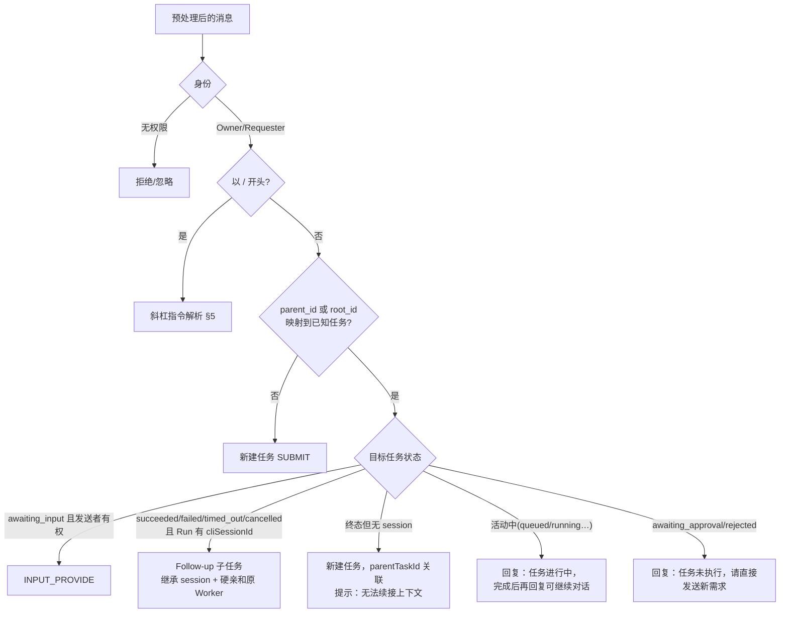

# 05 · 飞书接入协议规格

> 对应代码：`packages/hub/src/plugins/channel-feishu/`、`packages/protocol/src/feishu/{commands,card-actions}.ts`。
> SDK：`@larksuiteoapi/node-sdk`（已核对 `1.77.0` 类型声明：`WSClient`、`EventDispatcher.register()`、`onReady/onError/onReconnecting/onReconnected`、`close()`、`getConnectionStatus()`）。

---

## 1. 前置配置（飞书开放平台）

| 项 | 要求 |
| :--- | :--- |
| 应用类型 | 企业自建应用，开启“机器人”能力 |
| 事件订阅方式 | **使用长连接接收事件**（事件与回调两处都要选长连接） |
| 订阅事件 | `im.message.receive_v1` |
| 订阅回调 | `card.action.trigger`（卡片回传交互） |
| 权限（以控制台实际名称为准，Phase 0 核对） | 接收群聊 @机器人消息、接收单聊消息、以应用身份发消息、更新应用发送的消息（卡片）、获取群信息（可选，用于显示群名） |
| 外部群 | 若接收方在**外部群**，需在应用设置中开启对外共享能力；否则机器人无法进入外部群（列为部署前置检查项） |
| 环境变量 | `FEISHU_APP_ID`、`FEISHU_APP_SECRET`（仅 env）；`hub.yaml` 中配置 `ownerOpenIds`、`requesterAllowlist`、`allowedChatIds` |

---

## 2. 插件结构与可测试性

```ts
// channel-feishu/transport.ts —— 唯一接触 SDK 的文件；测试中以 FakeFeishuTransport 替换
export interface FeishuTransport {
  start(handlers: {
    onMessage(evt: FeishuMessageEvent): Promise<void>
    onCardAction(evt: FeishuCardActionEvent): Promise<CardActionResponse>   // 必须 3 s 内返回
  }): Promise<void>
  close(): Promise<void>
  status(): 'connecting' | 'connected' | 'reconnecting' | 'failed'
  botInfo(): Promise<{ openId: string; name: string }>
  replyMessage(messageId: string, msg: OutboundMessage, opts?: { replyInThread?: boolean }): Promise<{ messageId: string }>
  sendMessage(receive: { idType: 'open_id' | 'chat_id'; id: string }, msg: OutboundMessage): Promise<{ messageId: string }>
  patchCard(messageId: string, card: CardJson): Promise<void>               // im.message.patch
}
export type OutboundMessage = { type: 'text'; text: string } | { type: 'interactive'; card: CardJson }
```

SDK 实现要点：

```ts
const client = new lark.Client({ appId, appSecret, domain: lark.Domain.Feishu })
const dispatcher = new lark.EventDispatcher({}).register({
  'im.message.receive_v1': (data) => { void handlers.onMessage(normalize(data)) },   // 立即返回，异步处理
  'card.action.trigger': (data) => handlers.onCardAction(normalizeAction(data)),     // 返回值即回调响应
})
const ws = new lark.WSClient({
  appId, appSecret, autoReconnect: true, handshakeTimeoutMs: 10_000,
  onReady, onError, onReconnecting, onReconnected,     // → 更新状态并 emit hub/status
})
await ws.start({ eventDispatcher: dispatcher })
// ctx.effect 中 yield () => ws.close()
```

- `im.message.receive_v1` 处理器**必须立即返回**（异步消化），避免长连接事件超时导致平台重推。
- `card.action.trigger` 处理器必须在 **3 秒**内返回响应（Toast + 可选的新卡片），慢操作异步执行。

---

## 3. 身份与权限

| 角色 | 判定 | 能力 |
| :--- | :--- | :--- |
| **Owner** | `sender.sender_id.open_id ∈ ownerOpenIds` | 全部指令；审批卡片操作；可在任意会话（含私聊）中发起 |
| **Requester** | `open_id ∈ requesterAllowlist` **或** (`requesterPolicy='chat'` 且消息来自 `allowedChatIds` 中的群) | 提交任务、查看自己任务、取消自己任务（受 02 §3.5 约束）、在自己任务卡片上回复续跑 |
| 其他 | 以上都不满足 | 私聊：回复“暂无使用权限，请联系管理员”（每用户每 24h 最多 1 次）；群聊：静默忽略 |

`open_id` 是应用维度的 ID：`ownerOpenIds` 必须用**本应用**下的 open_id（Phase 0 提供 `/whoami` 指令：任何人私聊机器人发 `/whoami` 返回自己的 open_id，便于配置）。

---

## 4. 消息路由

### 4.1 预处理

1. **去重**：以 `header.event_id` 写入 `feishu_event_dedupe`（主键冲突 → 丢弃）；另以 `message.message_id` 二次去重（平台重推时 event_id 可能变化）。TTL 7 天，由 retention 清理。
2. **过滤**：`sender.sender_type != 'user'`（机器人/应用消息）→ 丢弃；消息 `create_time` 早于 Hub 启动前 `staleMessageMs = 10 min` → 丢弃（防长连接恢复后的历史积压误触发执行），并在 Owner 私聊发一条汇总提示。
3. **类型**：`text` → 取 `content.text`；`post`（富文本）→ 拼接所有 `text`/`a` 节点文本；其他类型（图片、文件、卡片等）→ 回复“暂仅支持文本需求”（v1）。
4. **群聊 @ 判定**：`chat_type='group'` 时，仅当 `mentions[].id.open_id == botOpenId`（启动时通过 `botInfo()` 获取）才处理；去除文本中的 `@_user_N` 占位符与首尾空白。
5. **长度**：去除后为空 → 回复帮助；超过 `maxPromptChars = 32000` → 回复“需求过长”。

### 4.2 路由决策



- **引用映射**：`feishu_messages` 表记录本系统相关的所有消息 ID（用户原始需求消息、进度卡片、结果卡片、审批卡片）→ `task_id`。查找顺序：`parent_id` → `root_id`。
- Follow-up 权限：Requester 只能续接**自己发起的**任务链；Owner 可续接任何任务。
- Follow-up 默认继承父任务的 `adapter`、`workspaceId`、`profile`，并以原 Worker 为 `required_worker_id`；该 Worker 离线时任务排队并在卡片上显示“等待 xxx 节点上线”。

### 4.3 新建任务默认值

| 字段 | 来源 |
| :--- | :--- |
| `workspaceId` | 指令 `--ws` > 会话绑定（`feishu.chatDefaults[chatId].workspaceId`）> `feishu.defaultWorkspaceId`；均无 → 回复“请指定工作区”并列出可用工作区 |
| `adapter` | 指令 `--cli` > 会话绑定 > 全局默认顺序 |
| `profile` | 指令 `--profile`（仅 Owner）> 会话绑定 > Requester 默认 `edit`（受策略 H1 上限约束，默认需 Owner 审批）、Owner 默认 `edit` |
| `title` | 文本前 80 字符 |

---

## 5. 斜杠指令

### 5.1 文法

```ebnf
command   = "/" name { ws arg } ;
name      = "run" | "status" | "tasks" | "workers" | "cancel" | "retry"
          | "approve" | "reject" | "drain" | "help" | "whoami" ;
arg       = flag | value ;
flag      = "--" key [ "=" value ] ;          (* 也支持 --key value 形式 *)
value     = quoted | bare ;
quoted    = '"' { char | '\"' } '"' | "“" { char } "”" ;   (* 兼容中文引号 *)
taskRef   = "#" digits | digits | "tsk_" ulid ;
```

解析器为手写分词器（不使用 shell 解析库）；`/run` 中第一个非 flag token 起直到行尾的全部原文即为 prompt（保留换行）。

### 5.2 指令表

| 指令 | 角色 | 说明 |
| :--- | :--- | :--- |
| `/run [--cli=<adapter>] [--ws=<workspace>] [--worker=<id>] [--profile=readonly\|edit\|full] [--priority=<n>] <需求>` | Owner/Requester（`--worker`、`--profile=full`、`--priority` 仅 Owner） | 显式建任务 |
| `/status [taskRef]` | 两者 | 无参数：本人活动任务列表（Owner：全部活动任务前 10）；有参数：任务状态卡片 |
| `/tasks [mine\|all] [--status=...]` | Owner（Requester 只能 `mine`） | 最近 10 个任务 |
| `/workers` | Owner | Worker 列表卡片（在线、槽位、adapter 徽章） |
| `/cancel <taskRef>` | 两者（受权限约束） | CANCEL |
| `/retry <taskRef>` | Owner | RETRY |
| `/approve <taskRef>` / `/reject <taskRef> [理由]` | Owner | 文本方式审批（卡片失效时的后备） |
| `/drain <workerId> on\|off` | Owner | Drain 模式 |
| `/help` | 两者 | 帮助（按角色显示） |
| `/whoami` | 任何人（仅私聊） | 返回 open_id |

解析错误（未知指令 / 未知 flag / 缺少参数 / 非法值）→ 回复文本错误 + 用法提示，**不创建任务**。

```ts
// packages/protocol/src/feishu/commands.ts
export type ParsedCommand =
  | { name: 'run'; flags: { cli?: AdapterId; ws?: string; worker?: string; profile?: Profile; priority?: number }; prompt: string }
  | { name: 'status'; taskRef?: TaskRef } | { name: 'tasks'; scope: 'mine' | 'all'; status?: TaskStatus[] }
  | { name: 'workers' } | { name: 'cancel' | 'retry' | 'approve'; taskRef: TaskRef }
  | { name: 'reject'; taskRef: TaskRef; reason?: string } | { name: 'drain'; workerId: string; on: boolean }
  | { name: 'help' } | { name: 'whoami' }
export function parseCommand(text: string): { ok: true; cmd: ParsedCommand } | { ok: false; error: string; usage: string }
```

---

## 6. 卡片体系（Card JSON 2.0）

### 6.1 卡片种类与投递位置

| 卡片 | 接收者 | 投递位置 | 原地更新 |
| :--- | :--- | :--- | :--- |
| **进度卡片** `TaskProgressCard` | 发起人（Requester/Owner） | 回复用户原消息（群聊中为引用回复） | 是：整个生命周期同一张卡片 `patch` |
| **审批卡片** `ApprovalCard` | Owner | 默认 Owner 私聊（`approvalTarget='owner_p2p'`）；可配置为来源会话 | 是：决策后变为“已批准/已驳回”只读态 |
| **结果补充消息** | 发起人 | 结果正文 > `cardResultMaxChars`（2000）时，额外回复一条文本/富文本消息（≤ 25 000 字符，更长则截断并附面板链接） | 否 |
| **Worker 列表 / 状态查询卡片** | 指令发起人 | 回复指令消息 | 否（一次性） |

**设计决策（D-FS-1）**：审批卡片默认发到 Owner 私聊，而不是外部群。理由：审批卡片包含工作区、CLI、权限档位等内部信息；外部接收方只能看到进度卡片的“等待审批”状态。

### 6.2 进度卡片状态机

| 卡片状态 | 对应 TaskStatus | 头部模板色 | 内容 | 按钮 |
| :--- | :--- | :--- | :--- | :--- |
| `pending_approval` | awaiting_approval | grey | 需求摘要、任务号、“等待负责人审批” | [取消]（发起人） |
| `queued` | queued, dispatching | blue | 排队位置（若可算）、`scheduleHint` | [取消] |
| `running` | running, cancelling | wathet | 已耗时、当前阶段、最新 ≤5 行进展（已脱敏，Requester 只显示 `progress`/agent 摘要级别） | [中止]、[打开面板]（仅 Owner 可见链接） |
| `awaiting_input` | awaiting_input | orange | 问题与选项 | 选项按钮 / “直接回复本卡片作答” |
| `succeeded` | succeeded | green | 结果摘要（≤2000 字符）、耗时、改动文件数 | “回复本卡片可继续对话” 提示 |
| `failed` | failed, timed_out | red | 错误摘要（脱敏）、尝试次数 | [重试]（仅 Owner 或策略允许） |
| `cancelled` / `rejected` | cancelled, rejected | grey | 原因 | — |

卡片渲染为纯函数 `renderProgressCard(view: TaskCardModel, audience: 'owner' | 'requester') → CardJson`，`TaskCardModel` 只包含渲染所需字段，便于快照测试。

### 6.3 卡片骨架

```json
{
  "schema": "2.0",
  "config": { "update_multi": true, "width_mode": "fill" },
  "header": {
    "title": { "tag": "plain_text", "content": "#128 · 执行中" },
    "subtitle": { "tag": "plain_text", "content": "claude-code · backend · 已运行 3m12s" },
    "template": "wathet"
  },
  "body": {
    "elements": [
      { "tag": "markdown", "content": "**需求**：修复登录页在 Safari 下的样式错位…" },
      { "tag": "markdown", "content": "```\n> 读取 src/pages/Login.tsx\n> 修改 2 个文件\n```" },
      { "tag": "button", "text": { "tag": "plain_text", "content": "中止" }, "type": "danger",
        "behaviors": [ { "type": "callback", "value": { "v": 1, "a": "cancel", "t": "tsk_01J…", "ver": 7 } } ],
        "confirm": { "title": { "tag": "plain_text", "content": "确认中止？" }, "text": { "tag": "plain_text", "content": "将终止本机进程" } } }
    ]
  }
}
```

- `update_multi: true` 是共享卡片原地更新的前提（JSON 2.0 必须）。
- 卡片 JSON 序列化后 ≤ `cardMaxBytes = 28 KiB`（平台上限约 30 KB，留余量）；超出时依次截断：进展行 → 结果摘要 → 需求摘要。
- 审批卡片使用 `form` 容器：`select_static`（adapter）、`select_static`（workspace）、`select_static`（profile）+ 两个提交按钮 [批准] [驳回]，回调中读取 `action.form_value`。

### 6.4 按钮回调值 Schema

```ts
// packages/protocol/src/feishu/card-actions.ts
export const CardActionValue = z.object({
  v: z.literal(1),
  a: z.enum(['approve', 'reject', 'cancel', 'retry', 'input_option', 'publish_result', 'suppress_result']),
  t: TaskId,
  ver: z.number().int(),              // 渲染卡片时的 task.version
  opt: z.string().max(200).optional(),// input_option 的选项文本
  req: z.string().optional(),         // input requestId
})
```

---

## 7. 卡片回调处理与并发点击幂等

```text
onCardAction(evt):                                  // 必须在 3s 内返回
  1. 去重：evt.event_id 已处理 → 返回 { toast: info "已处理" }
  2. 解析 value（Zod）失败 → toast error "卡片已过期"
  3. 鉴权：operator.open_id → 角色；无权 → toast error "仅负责人可操作"（不改卡片）
  4. 获取进程内锁 KeyedMutex(`card:${taskId}`)，tryLock 超时 200ms：
       获取失败 → toast info "正在处理，请稍候"（并发双击的第二次）
  5. 读取 task：
       task.version != value.ver 且 动作已不合法 → toast info "任务状态已变化" + 返回最新卡片（自愈旧卡片）
       task.version != value.ver 但动作仍合法（例如 cancel） → 继续（以当前状态为准）
  6. 调用 orchestrator.<action>(taskId, actor, { expectedVersion: task.version })
       超过 2.0 s 未完成 → 立即返回 toast "已提交"，结果由 CardUpdater 异步 patch
  7. 返回 { toast: success "已批准", card: { type: 'raw', data: renderXxx(newState) } }
       —— 直接用回调响应更新卡片，不消耗 im.message.patch 配额，并把该卡片在 CardUpdater 中标记为“已是最新 version”
  8. 释放锁；写审计（channel='feishu', action, eventId）
```

三层防护：`event_id` 去重（平台重推）→ 进程内 `KeyedMutex`（同实例并发）→ 状态机 CAS + 合法性校验（跨渠道：面板与飞书同时审批，后到者得到 `INVALID_TRANSITION`，Toast 显示“已被处理（由 xxx 于 hh:mm 批准）”）。

---

## 8. 卡片更新节流与限流（`CardUpdater`）

### 8.1 目标

- 不触发飞书限流（HTTP 429 或业务码 `99991400` 等频控错误）；
- 同一张卡片按“**最新状态胜出**”合并，绝不按事件逐条 patch；
- 卡片更新失败**永不影响**任务状态。

### 8.2 算法

```text
数据结构：
  cards: Map<messageId, { desired: CardModel, desiredHash, sentHash, lastPatchAt, backoffUntil, inFlight, priority }>
  globalBucket: TokenBucket(rate = globalPatchQps(默认 5/s), burst = 10)

on task/transitioned | run/events(进展变化) for task T:
  for each card bound to T (feishu_messages.role ∈ {progress_card, approval_card}):
     model = buildModel(T); hash = stableHash(render(model))
     if hash == card.desiredHash: continue        // 内容未变化（如只有日志但进展行未变）
     card.desired = model; card.desiredHash = hash
     card.priority = isStateChange ? HIGH : NORMAL
     schedule(card)

schedule(card):
  earliest = max(card.lastPatchAt + (priority==HIGH ? minPatchIntervalHighMs(1000) : minPatchIntervalMs(3000)),
                 card.backoffUntil)
  定时到 earliest 后（同一卡片只保留一个定时器）→ tryPatch(card)

tryPatch(card):
  if card.inFlight: 标记 dirty，结束后重新 schedule
  if card.desiredHash == card.sentHash: return
  if !globalBucket.take(): 50~150ms 抖动后重试
  inFlight = true; snapshotHash = card.desiredHash
  try transport.patchCard(id, render(card.desired))
     ok  → sentHash = snapshotHash; lastPatchAt = now; failures = 0
     429/频控码 → backoffUntil = now + min(30s, 2s × 2^failures)；全局：1 分钟内 ≥3 次限流 → globalBucket 速率减半 5 分钟
     卡片不可更新（消息已撤回 / 超过可编辑期 / 非本应用消息）→ 标记 card dead，若任务仍活动则发送新卡片并更新绑定
     其他错误 → 指数退避重试，最多 5 次后放弃（记录告警）
  finally inFlight = false; if desiredHash != sentHash → schedule(card)
```

- **终态优先**：任务进入终态时以 HIGH 优先级排队，并在 Hub 关闭时 `flush()`（最长 3 s）。
- **队列上限**：`cards` 只保留活动任务及终态后 10 min 内的卡片（LRU 上限 2 000）。
- **发送消息**限流：`replyMessage`/`sendMessage` 走独立令牌桶：全局 5/s，每会话 1/s（防群内刷屏）。
- 默认值均可热更新（`feishu.card.*`）。频控阈值以飞书官方文档为准，Phase 0 核对后写入默认配置。

### 8.3 进展行提取

`run/events` → `ProgressExtractor`（纯函数）：只从 `progress`、`agent(tool_use|file_change|message)` 事件中提取 ≤ 5 行人类可读进展（如“读取 src/a.ts”、“修改 2 个文件”、“执行 npm test”），**不**把原始 stdout 推给飞书。Requester 受众进一步过滤掉命令行与文件绝对路径（仅显示相对路径与动作类型）。

---

## 9. 结果回传与隐私

- 结果正文（`finished.summary`）在 Hub 侧二次脱敏（与 Worker 同一规则集 + Hub 附加规则）后再发送。
- 策略 `requesterReplyPolicy`：`auto`（默认，完成即回传）| `owner_review`（任务 `succeeded` 时 `tasks.result_delivery_status` 置为 `pending_review`，结果先发 Owner 私聊审核卡片，附 `[发送给对方]`（`a:'publish_result'`）与 `[不发送]`（`a:'suppress_result'`）按钮；面板亦提供 `POST /api/v1/tasks/:ref/deliver-result`；经 CAS 将状态推进至 `delivered`/`suppressed` 后才向 Requester 更新终态卡片，天然防重复发送且跨 Hub 重启不丢失状态）。
- 面板链接只在 Owner 受众的卡片中出现。
- 失败时 Requester 只看到错误类别（如“执行超时”“节点离线”），不显示 stderr。

---

## 10. 连接状态与降级

| WSClient 回调 | 插件状态 | 行为 |
| :--- | :--- | :--- |
| `onReady` | `connected` | emit `hub/status` |
| `onReconnecting` | `reconnecting` | 面板态势栏黄灯；CardUpdater 暂停（保留 desired，恢复后补发） |
| `onReconnected` | `connected` | 恢复 |
| `onError`（重试耗尽） | `failed` | Fiber 抛错进入 FAILED → `supervisor` 退避重启；Hub 其余功能不受影响 |

飞书断连期间平台可能缓存并在恢复后推送积压事件 → 由 §4.1 的去重与 `staleMessageMs` 过滤兜底。

---

## 11. Phase 7 增量（Blackboard & Harness，权威规格见 [08](08-blackboard-harness.md)）

> 原则：Requester 受众看不到任何 Harness 细节（D-11）；接力 / 修复只对 Owner 开放且只在 Owner 私聊出现（D-BB-8）；所有新卡片元素只在模型含 `harness` 时渲染，既有卡片快照不变。

| 本文位置 | Phase 7 增量 | 08 |
| :--- | :--- | :--- |
| §4.2 路由 | **普通引用回复不变**：仍走同 CLI `followUp()` + `--resume`，不重复注入 `.board/`（仅在有新的验证失败或穿插写入时附带 `<verified_facts>`） | §3.5、§4.4 |
| §5 指令 | 新增 `/handoff --cli=<adapter> [--from=<taskRef\|runId>] [需求]`；`/run` 新增 `--from=<taskRef\|runId>`；两者仅 Owner、仅私聊；帮助文本只在 Owner 列表末尾追加 `、/handoff` | §10.1 |
| §6.2 进度卡片 | Owner 受众终态追加：验证徽章、黑板变更摘要（文件名与行数）、告警（`TAMPER_RISK` / 只读违规 / 黑板不安全 / 超预算）、按钮 `[带报错修复]` 与表单 `[换 CLI 接力]` / `[换 CLI 修复]`；交接子任务显示“接力自 #n” | §10.3 |
| §6.3 审批卡片 | Requester 任务的审批表单追加 `harness` 选择（默认 / 启用黑板 / 黑板+验证 / 关闭） | §10.2 |
| §6.4 回调值 | `a` 追加 `handoff`、`fix`；可选 `r`（fromRunId）；表单字段 `cli`、`prompt` | §10.2 |
| §7 回调处理 | `handoff` / `fix` 映射到 `followup` 权限且为 Owner 专属；成功后新进度卡片发往 Owner 私聊 | §10.2 |
| §8.3 进展提取 | `verify` 事件 → Owner：“验证 #k：…”；Requester：“正在进行自动验证” | §10.4 |
| §9 结果回传 | Requester 任务的黑板文件被删除、验证未通过或 `TAMPER_RISK` 时，结果强制 `pending_review`（与 `requesterReplyPolicy` 无关） | §8.6 |
