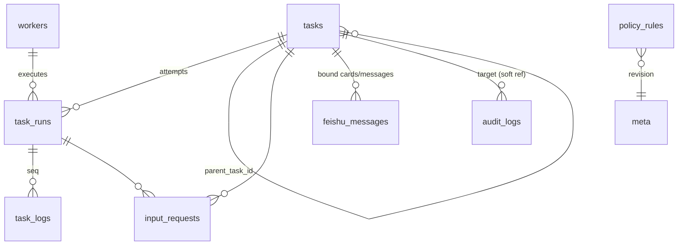
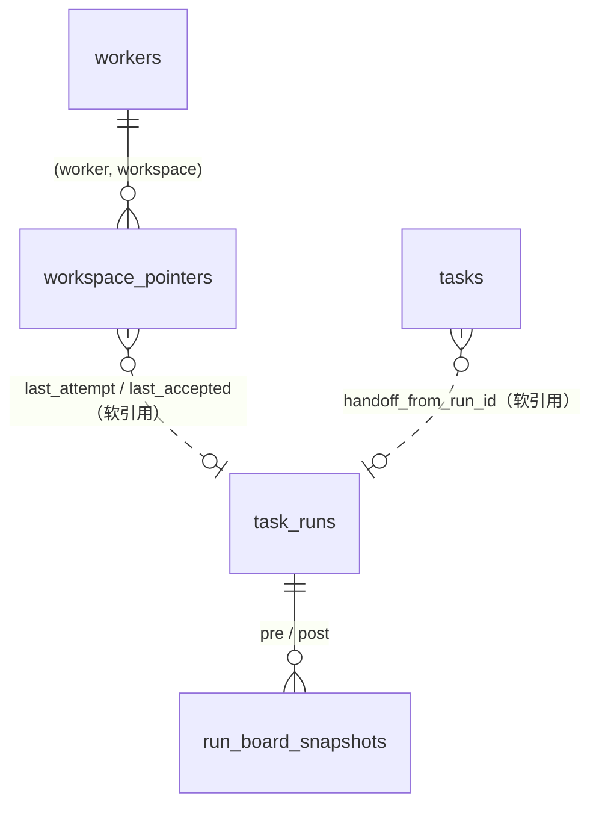

# 07 · 数据库 Schema（SQLite WAL + Drizzle ORM）

> 对应代码：`packages/hub/src/plugins/store-sqlite/schema.ts`、`packages/hub/migrations/`。
> 驱动：`better-sqlite3`（同步 API，单进程单写连接）+ `drizzle-orm/better-sqlite3`；迁移：`drizzle-kit generate` 生成 SQL 并提交入库，启动时 `migrate()` 自动执行。

---

## 1. 连接与 PRAGMA

Hub 进程持有**一个写连接**（所有写入串行化，与 better-sqlite3 同步模型一致）；只读查询（面板列表/日志分页）复用同一连接（better-sqlite3 下读同样很快，v1 不引入读连接池）。

```sql
-- 仅在新建数据库时（建表之前）执行一次：
PRAGMA page_size = 8192;
PRAGMA auto_vacuum = INCREMENTAL;     -- 必须在第一张表创建之前设置，否则需要 VACUUM 才生效

-- 每次打开连接执行：
PRAGMA journal_mode = WAL;
PRAGMA synchronous = NORMAL;          -- WAL 下 NORMAL 足够：进程崩溃不丢已提交事务，断电可能丢最后几个事务
PRAGMA foreign_keys = ON;
PRAGMA busy_timeout = 5000;
PRAGMA temp_store = MEMORY;
PRAGMA cache_size = -65536;           -- 64 MiB
PRAGMA wal_autocheckpoint = 1000;     -- 页
PRAGMA journal_size_limit = 67108864; -- checkpoint 后 WAL 文件截断到 64 MiB
```

- 时间字段：`INTEGER` epoch 毫秒。布尔：`INTEGER` 0/1（drizzle `mode: 'boolean'`）。JSON：`TEXT`（drizzle `mode: 'json'`）。
- ID：业务主键使用带前缀 ULID 的 `TEXT`（`tsk_…`、`run_…`），天然按时间有序；高频追加表（`task_logs`、`audit_logs`）使用 `INTEGER PRIMARY KEY`（rowid 别名）以获得最佳插入性能。
- 数据库文件：`/data/hub.sqlite`（Docker 卷）。**禁止**放在网络文件系统（NFS/SMB）上——WAL 依赖共享内存。

---

## 2. ER 概览



---

## 3. Drizzle 表定义

```ts
// packages/hub/src/plugins/store-sqlite/schema.ts
import { sqliteTable, text, integer, index, uniqueIndex, primaryKey } from 'drizzle-orm/sqlite-core'
import { sql } from 'drizzle-orm'

const ts = (name: string) => integer(name)                       // epoch ms
const bool = (name: string) => integer(name, { mode: 'boolean' })

// ───────────────────────────── meta（全局计数器与修订号）─────────────────────────────
export const meta = sqliteTable('meta', {
  key: text('key').primaryKey(),              // 'schema_version' | 'task_no_seq' | 'policy_revision' | 'hub_boot_id'
  value: text('value').notNull(),
})

// ───────────────────────────── tasks ─────────────────────────────
export const tasks = sqliteTable('tasks', {
  id: text('id').primaryKey(),                                  // tsk_<ULID>
  taskNo: integer('task_no').notNull(),                         // 展示编号 #123，由 meta.task_no_seq 分配
  version: integer('version').notNull().default(0),             // 乐观锁，每次迁移 +1
  status: text('status', { enum: ['awaiting_approval', 'queued', 'dispatching', 'running', 'awaiting_input',
    'cancelling', 'succeeded', 'rejected', 'failed', 'timed_out', 'cancelled'] }).notNull(),
  parentTaskId: text('parent_task_id').references((): any => tasks.id, { onDelete: 'set null' }),
  rootTaskId: text('root_task_id'),                             // 对话链根（自身为根时 = id）
  source: text('source', { enum: ['feishu', 'dashboard', 'api'] }).notNull(),
  originJson: text('origin_json', { mode: 'json' }).notNull(),  // TaskOrigin（飞书 chatId/messageId 等）
  requesterType: text('requester_type', { enum: ['owner', 'requester'] }).notNull(),
  requesterId: text('requester_id').notNull(),                  // open_id 或 'dashboard:owner'
  requesterName: text('requester_name'),
  title: text('title').notNull(),
  prompt: text('prompt').notNull(),
  priority: integer('priority').notNull().default(0),
  // —— 执行约束 ——
  adapter: text('adapter'),                                     // 明确指定的 adapter（null = 自动）
  adapterPrefsJson: text('adapter_prefs_json', { mode: 'json' }).$type<string[]>(),
  workspaceId: text('workspace_id').notNull(),
  subdir: text('subdir'),
  profile: text('profile', { enum: ['readonly', 'edit', 'full'] }).notNull(),
  model: text('model'),
  requiredWorkerId: text('required_worker_id'),
  preferredWorkerId: text('preferred_worker_id'),
  resumeSessionId: text('resume_session_id'),                   // Follow-up 继承的 cli_session_id
  timeoutMs: integer('timeout_ms').notNull(),
  maxAttempts: integer('max_attempts').notNull().default(3),
  runSeq: integer('run_seq').notNull().default(0),              // 累计创建的 Run 序号（含 refused），用于 task_runs 唯一键
  attemptCount: integer('attempt_count').notNull().default(0),  // 有效尝试次数（不含 refused），对照 maxAttempts
  currentRunId: text('current_run_id'),                         // 不加 FK（与 task_runs 互相引用，避免插入顺序问题）
  // —— 策略与审批 ——
  policyDecisionJson: text('policy_decision_json', { mode: 'json' }).notNull(),
  approvalDeadlineAt: ts('approval_deadline_at'),
  decidedBy: text('decided_by'),
  decidedAt: ts('decided_at'),
  rejectReason: text('reject_reason'),
  // —— 结果 ——
  resultSummary: text('result_summary'),
  resultDeliveryStatus: text('result_delivery_status', { enum: ['not_required', 'pending_review', 'delivered', 'suppressed'] }).notNull().default('not_required'),
  resultDeliveredAt: ts('result_delivered_at'),
  cliSessionId: text('cli_session_id'),                         // 最近一次成功 Run 的会话
  errorCode: text('error_code'),
  errorMessage: text('error_message'),
  lastProgress: text('last_progress'),
  scheduleHint: text('schedule_hint'),
  // —— 时间 ——
  createdAt: ts('created_at').notNull(),
  updatedAt: ts('updated_at').notNull(),
  queuedAt: ts('queued_at'),
  startedAt: ts('started_at'),
  finishedAt: ts('finished_at'),
}, (t) => [
  uniqueIndex('ux_tasks_task_no').on(t.taskNo),
  // 调度器扫描：WHERE status='queued' ORDER BY priority DESC, queued_at ASC
  index('ix_tasks_sched').on(t.status, t.priority, t.queuedAt),
  index('ix_tasks_created').on(t.createdAt),
  index('ix_tasks_requester').on(t.requesterId, t.createdAt),
  index('ix_tasks_parent').on(t.parentTaskId),
  index('ix_tasks_root').on(t.rootTaskId),
  index('ix_tasks_finished').on(t.finishedAt),                 // 保留策略与“今日统计”
])

// ───────────────────────────── task_runs ─────────────────────────────
export const taskRuns = sqliteTable('task_runs', {
  id: text('id').primaryKey(),                                  // run_<ULID>
  taskId: text('task_id').notNull().references(() => tasks.id, { onDelete: 'cascade' }),
  runSeq: integer('run_seq').notNull(),                         // 任务内单调递增（含 refused）
  attempt: integer('attempt').notNull(),                        // 对应的尝试序号（refused 后下次复用同 attempt 但 runSeq 递增）
  workerId: text('worker_id').notNull().references(() => workers.id),
  adapter: text('adapter').notNull(),
  workspaceId: text('workspace_id').notNull(),
  profile: text('profile').notNull(),                           // 实际生效（可能被 Worker clamp）
  status: text('status', { enum: ['dispatching', 'running', 'awaiting_input', 'cancelling', 'succeeded',
    'failed', 'timed_out', 'cancelled', 'refused', 'lost'] }).notNull(),
  dispatchCount: integer('dispatch_count').notNull().default(1),// 派发重发次数
  notAfter: ts('not_after').notNull(),
  connectionEpoch: integer('connection_epoch'),                 // 受理时的连接纪元
  pid: integer('pid'),
  cliVersion: text('cli_version'),
  cliSessionId: text('cli_session_id'),
  commandSummary: text('command_summary'),
  exitCode: integer('exit_code'),
  signal: text('signal'),
  errorCode: text('error_code'),
  errorMessage: text('error_message'),
  summary: text('summary'),
  usageJson: text('usage_json', { mode: 'json' }),
  filesChangedJson: text('files_changed_json', { mode: 'json' }),
  lastSeq: integer('last_seq').notNull().default(0),            // 已持久化的最大连续 seq（= Hub ackSeq）
  logBytes: integer('log_bytes').notNull().default(0),
  logDroppedBytes: integer('log_dropped_bytes').notNull().default(0),  // Hub 侧截断 + Worker dropped 事件累计
  logTruncated: bool('log_truncated').notNull().default(false),
  cancelRequestedAt: ts('cancel_requested_at'),
  cancelReason: text('cancel_reason'),
  dispatchedAt: ts('dispatched_at').notNull(),
  ackedAt: ts('acked_at'),
  startedAt: ts('started_at'),
  finishedAt: ts('finished_at'),
  logsPurgedAt: ts('logs_purged_at'),                           // 日志被保留策略清理的时间
}, (t) => [
  uniqueIndex('ux_runs_task_seq').on(t.taskId, t.runSeq),
  index('ix_runs_worker_status').on(t.workerId, t.status),     // 对账/槽位统计
  index('ix_runs_status').on(t.status),
  index('ix_runs_finished').on(t.finishedAt),                  // 保留策略
])

// ───────────────────────────── task_logs ─────────────────────────────
export const taskLogs = sqliteTable('task_logs', {
  id: integer('id').primaryKey(),                               // rowid 别名，追加最快
  runId: text('run_id').notNull().references(() => taskRuns.id, { onDelete: 'cascade' }),
  seq: integer('seq').notNull(),
  ts: ts('ts').notNull(),                                       // Worker 事件时间（展示用）
  kind: text('kind', { enum: ['started', 'log', 'agent', 'session', 'progress', 'input_request',
    'dropped', 'gap', 'finished', 'system'] }).notNull(),
  stream: text('stream', { enum: ['stdout', 'stderr', 'system'] }),
  text: text('text'),                                           // log 文本（已脱敏，≤16 KiB）
  dataJson: text('data_json', { mode: 'json' }),                // 结构化负载
  bytes: integer('bytes').notNull(),                            // text + data 的字节数，用于配额统计
}, (t) => [
  // 核心查询：WHERE run_id=? AND seq>? ORDER BY seq LIMIT ?  —— 唯一索引同时保证幂等（重复 seq 插入失败）
  uniqueIndex('ux_logs_run_seq').on(t.runId, t.seq),
])

// ───────────────────────────── workers ─────────────────────────────
export const workers = sqliteTable('workers', {
  id: text('id').primaryKey(),                                  // 'win-desktop'
  displayName: text('display_name').notNull(),
  publicKey: text('public_key').notNull(),                      // Ed25519 SPKI DER base64
  keyFingerprint: text('key_fingerprint').notNull(),
  status: text('status', { enum: ['active', 'revoked'] }).notNull().default('active'),
  drain: bool('drain').notNull().default(false),
  drainSource: text('drain_source', { enum: ['hub', 'worker'] }),
  connection: text('connection', { enum: ['online', 'suspect', 'offline'] }).notNull().default('offline'),
  connectionEpoch: integer('connection_epoch').notNull().default(0),
  hostname: text('hostname'),
  os: text('os'),
  arch: text('arch'),
  agentVersion: text('agent_version'),
  maxConcurrency: integer('max_concurrency').notNull().default(1),
  capabilitiesJson: text('capabilities_json', { mode: 'json' }),     // AdapterCapability[]（最近一次 hello/心跳）
  workspacesJson: text('workspaces_json', { mode: 'json' }),         // WorkspaceDecl[]
  lastIp: text('last_ip'),
  lastSeenAt: ts('last_seen_at'),
  connectedAt: ts('connected_at'),
  disconnectedAt: ts('disconnected_at'),
  lastDispatchAt: ts('last_dispatch_at'),
  createdAt: ts('created_at').notNull(),
  updatedAt: ts('updated_at').notNull(),
  revokedAt: ts('revoked_at'),
})

// ───────────────────────────── input_requests ─────────────────────────────
export const inputRequests = sqliteTable('input_requests', {
  id: text('id').primaryKey(),                                  // Worker 生成的 requestId
  taskId: text('task_id').notNull().references(() => tasks.id, { onDelete: 'cascade' }),
  runId: text('run_id').notNull().references(() => taskRuns.id, { onDelete: 'cascade' }),
  question: text('question').notNull(),
  optionsJson: text('options_json', { mode: 'json' }),
  status: text('status', { enum: ['open', 'answered', 'delivered', 'expired', 'cancelled'] }).notNull(),
  answer: text('answer'),
  answeredBy: text('answered_by'),
  createdAt: ts('created_at').notNull(),
  expiresAt: ts('expires_at').notNull(),
  answeredAt: ts('answered_at'),
  deliveredAt: ts('delivered_at'),                              // 收到 run.input 的 cmd.ack
}, (t) => [index('ix_inputs_task').on(t.taskId), index('ix_inputs_status').on(t.status, t.expiresAt)])

// ───────────────────────────── feishu_messages ─────────────────────────────
export const feishuMessages = sqliteTable('feishu_messages', {
  messageId: text('message_id').primaryKey(),                   // om_xxx
  taskId: text('task_id').notNull().references(() => tasks.id, { onDelete: 'cascade' }),
  role: text('role', { enum: ['request', 'progress_card', 'approval_card', 'result_text', 'input_prompt', 'reply'] }).notNull(),
  chatId: text('chat_id').notNull(),
  chatType: text('chat_type', { enum: ['p2p', 'group'] }).notNull(),
  audience: text('audience', { enum: ['owner', 'requester'] }),
  senderOpenId: text('sender_open_id'),                         // role=request 时为用户
  cardHash: text('card_hash'),                                  // 最近一次成功推送的渲染哈希
  cardTaskVersion: integer('card_task_version'),
  dead: bool('dead').notNull().default(false),                  // 不可再 patch
  createdAt: ts('created_at').notNull(),
  lastPatchedAt: ts('last_patched_at'),
}, (t) => [index('ix_fsmsg_task').on(t.taskId, t.role)])

export const feishuEventDedupe = sqliteTable('feishu_event_dedupe', {
  key: text('key').primaryKey(),                                // 'evt:<event_id>' | 'msg:<message_id>' | 'act:<event_id>'
  receivedAt: ts('received_at').notNull(),
}, (t) => [index('ix_fsdedupe_time').on(t.receivedAt)])

// ───────────────────────────── audit_logs ─────────────────────────────
export const auditLogs = sqliteTable('audit_logs', {
  id: integer('id').primaryKey(),
  ts: ts('ts').notNull(),
  actorType: text('actor_type', { enum: ['owner', 'requester', 'system', 'worker'] }).notNull(),
  actorId: text('actor_id').notNull(),
  channel: text('channel', { enum: ['feishu', 'dashboard', 'api', 'system'] }).notNull(),
  action: text('action').notNull(),                             // 'task.submit' | 'task.transition' | 'task.noop' | 'worker.drain' | 'config.applied' | ...
  targetType: text('target_type', { enum: ['task', 'run', 'worker', 'policy', 'config', 'session', 'token'] }).notNull(),
  targetId: text('target_id').notNull(),
  fromStatus: text('from_status'),
  toStatus: text('to_status'),
  detailJson: text('detail_json', { mode: 'json' }),            // 不含密钥；prompt 改写时含新旧摘要
  requestId: text('request_id'),
}, (t) => [
  index('ix_audit_target').on(t.targetType, t.targetId, t.ts),
  index('ix_audit_ts').on(t.ts),
  index('ix_audit_actor').on(t.actorId, t.ts),
])

// ───────────────────────────── policy_rules ─────────────────────────────
export const policyRules = sqliteTable('policy_rules', {
  id: text('id').primaryKey(),
  name: text('name').notNull(),
  priority: integer('priority').notNull(),
  enabled: bool('enabled').notNull().default(true),
  matchJson: text('match_json', { mode: 'json' }).notNull(),
  effectJson: text('effect_json', { mode: 'json' }).notNull(),
  updatedAt: ts('updated_at').notNull(),
  updatedBy: text('updated_by').notNull(),
}, (t) => [index('ix_policy_priority').on(t.priority)])

// ───────────────────────────── 鉴权相关 ─────────────────────────────
export const dashboardSessions = sqliteTable('dashboard_sessions', {
  id: text('id').primaryKey(),                                  // 会话 ULID
  tokenHash: text('token_hash').notNull(),                      // sha256(cookie 值)
  csrfToken: text('csrf_token').notNull(),
  createdAt: ts('created_at').notNull(),
  expiresAt: ts('expires_at').notNull(),
  lastSeenAt: ts('last_seen_at').notNull(),
  ip: text('ip'),
  userAgent: text('user_agent'),
  revokedAt: ts('revoked_at'),
}, (t) => [uniqueIndex('ux_sessions_hash').on(t.tokenHash), index('ix_sessions_expires').on(t.expiresAt)])

export const apiTokens = sqliteTable('api_tokens', {
  id: text('id').primaryKey(),
  name: text('name').notNull(),
  tokenHash: text('token_hash').notNull(),
  scopesJson: text('scopes_json', { mode: 'json' }).notNull(),
  createdAt: ts('created_at').notNull(),
  lastUsedAt: ts('last_used_at'),
  revokedAt: ts('revoked_at'),
}, (t) => [uniqueIndex('ux_api_tokens_hash').on(t.tokenHash)])

export const enrollTokens = sqliteTable('enroll_tokens', {
  tokenHash: text('token_hash').primaryKey(),
  suggestedWorkerId: text('suggested_worker_id'),
  createdBy: text('created_by').notNull(),
  createdAt: ts('created_at').notNull(),
  expiresAt: ts('expires_at').notNull(),
  usedAt: ts('used_at'),
  usedByWorkerId: text('used_by_worker_id'),
})

export const idempotencyKeys = sqliteTable('idempotency_keys', {
  scope: text('scope').notNull(),                               // 'POST /tasks' | 'feishu:message' ...
  key: text('key').notNull(),
  requestHash: text('request_hash').notNull(),
  responseJson: text('response_json', { mode: 'json' }).notNull(),
  createdAt: ts('created_at').notNull(),
}, (t) => [primaryKey({ columns: [t.scope, t.key] }), index('ix_idem_created').on(t.createdAt)])
```

> 坑：`tasks.parent_task_id` 自引用需要 `(): AnySQLiteColumn => tasks.id` 的惰性写法；`tasks.current_run_id` 与 `task_runs.task_id` 互相引用，故 `current_run_id` 不声明外键，由 INV-1 测试保证一致性。

---

## 4. 关键查询与索引对应

| 查询 | SQL 形态 | 使用索引 |
| :--- | :--- | :--- |
| 调度扫描 | `WHERE status='queued' ORDER BY priority DESC, queued_at ASC LIMIT 200` | `ix_tasks_sched`（SQLite 可反向扫描 priority 段） |
| 日志分页 | `WHERE run_id=? AND seq>? ORDER BY seq LIMIT 500` | `ux_logs_run_seq` 范围扫描 |
| 日志幂等写入 | `INSERT ... ON CONFLICT(run_id, seq) DO NOTHING` | `ux_logs_run_seq` |
| 活动 Run 对账 | `WHERE worker_id=? AND status IN (...)` | `ix_runs_worker_status` |
| 任务列表（默认） | `ORDER BY created_at DESC, id DESC`，游标 `(created_at, id)` | `ix_tasks_created` |
| 我的任务 | `WHERE requester_id=? ORDER BY created_at DESC` | `ix_tasks_requester` |
| 飞书引用回复 | `WHERE message_id=?` | 主键 |
| 任务时间线 | `WHERE target_type='task' AND target_id=? ORDER BY ts` | `ix_audit_target` |
| 今日统计 | `WHERE finished_at >= :dayStart` | `ix_tasks_finished` |
| prompt 全文 `q` | `WHERE prompt LIKE '%q%'`（v1 全表扫描，限定最近 90 天 + LIMIT） | — （backlog：FTS5 虚表） |

---

## 5. 日志写入路径（`IngestQueue`）

- 网关校验 seq 后调用 `store.ingest.enqueue(runId, events)`，返回的 Promise 在**包含这些事件的事务提交后** resolve（网关据此 ack）。
- 写入批次：每 `batchMs = 50 ms` 或累计 `batchRows = 500` 行触发一个事务：
  ```sql
  BEGIN IMMEDIATE;
    INSERT INTO task_logs (run_id, seq, ts, kind, stream, text, data_json, bytes) VALUES (...) ON CONFLICT DO NOTHING;  -- 多行
    UPDATE task_runs SET last_seq = :max, log_bytes = log_bytes + :bytes, log_dropped_bytes = ... WHERE id = :runId;      -- 每 Run 一次
  COMMIT;
  ```
- 状态类事件（`started`/`session`/`input_request`/`finished`）不走批量合并延迟：立即触发一次 flush，并在**同一事务**中执行状态机迁移，保证“日志 + 状态”原子一致。
- 队列有界（默认 50 000 行 / 64 MiB）；超过上限时 `enqueue` 返回的 Promise 延迟 resolve（自然形成对 Worker 的背压：不 ack → Worker 在途窗口满 → 暂停发送）。
- 每 Run 配额：`log_bytes ≥ maxBytesPerRun` 后，不再为每条被截断的 `log` 事件插入新行，而是写入**单条** `kind='gap'` 占位行（`seq = firstTruncatedSeq`，`data_json = {"toSeq": ..., "reason": "hub_cap", "droppedBytes": ...}`）；后续连续被截断的 `log` 事件原地更新该占位行的 `toSeq` 与 `droppedBytes`（同时推进 `task_runs.last_seq` 与 `log_dropped_bytes`），以 **O(1) 行数** 防止索引膨胀并保持 INV-7 区间连续性（与 03 §5.5 一致）。

## 6. 保留与清理策略（`retention` 插件）

| 数据 | 默认保留 | 清理方式 |
| :--- | :--- | :--- |
| `task_logs`（succeeded 任务的 Run） | 30 天（按 `task_runs.finished_at`） | 分片删除 |
| `task_logs`（其他终态） | 90 天 | 分片删除 |
| `task_logs`（活动 Run） | 永不 | — |
| `tasks` / `task_runs` / `input_requests` | 365 天 | 级联删除（先清日志） |
| `audit_logs` | 365 天 | 按 `ts` 分片删除 |
| `feishu_event_dedupe` | 7 天 | 按 `received_at` |
| `idempotency_keys` | 24 小时 | 按 `created_at` |
| `dashboard_sessions` / `enroll_tokens` | 过期后 7 天 | — |

**分片删除算法**（避免长时间持有写锁阻塞日志写入）：

```text
每 sliceIntervalMs（默认 10 s）执行一个分片：
  1. 选出一个待清理 Run：SELECT id FROM task_runs WHERE finished_at < :cutoff AND logs_purged_at IS NULL LIMIT 1
  2. DELETE FROM task_logs WHERE id IN (SELECT id FROM task_logs WHERE run_id=? LIMIT 5000)   -- 单事务 ≤ 5000 行
  3. 若删除行数 < 5000 → UPDATE task_runs SET logs_purged_at=now
  4. 每累计删除 100 000 行 → PRAGMA incremental_vacuum(2000)
每日 04:00（Hub 时区）：
  PRAGMA wal_checkpoint(TRUNCATE); PRAGMA optimize;
```

**容量护栏**：`store.health().dbSizeBytes` 超过 `maxDbBytes`（默认 10 GiB）的 80% → 面板告警，并临时把日志保留天数减半；超过 95% → 拒绝新的 `log` 文本持久化（仅保留非 log 事件），直到空间回落。

（backlog）冷归档：清理前将 Run 日志导出为 `/data/archive/<yyyy-mm>/<runId>.ndjson.gz`。

## 7. 迁移规范

- 迁移文件只增不改；破坏性变更采用“新增列 → 回填 → 切换读写 → 下个版本删除旧列”。
- 启动时：`BEGIN EXCLUSIVE` 内执行迁移；迁移前若 DB 已存在，自动备份为 `hub.sqlite.bak-<schemaVersion>-<ts>`（使用 `VACUUM INTO`，保留最近 3 份）。
- 迁移失败 → `store-sqlite` Fiber FAILED → 进程退出码 1（关键插件）。

---

## 8. Phase 7 增量（Blackboard & Harness，权威规格见 [08](08-blackboard-harness.md)）

> 迁移 `0003_blackboard_harness.sql`（7a 一次性落地，含 7b 列；`user_version` → 4）只包含 `ADD COLUMN`、新表与新索引，既有行的新列全为 `NULL`，INV-1~8 与所有 Phase 0–6 查询不受影响。精确 SQL 与 Drizzle 定义见 08 §8.3。

| 对象 | 增量 | 08 |
| :--- | :--- | :--- |
| `tasks` | `handoff_from_run_id`、`harness_request_json`；索引 `ix_tasks_handoff_from` | §8.3、§8.7 |
| `task_runs` | `harness_json`、`workspace_seq`、`verification_status`、`verification_json`；索引 `ix_runs_workspace_seq (worker_id, workspace_id, workspace_seq)`、部分索引 `ix_runs_verification` | §8.3–§8.5 |
| `task_logs` | `kind` 枚举追加 `harness` / `workspace` / `verify`（SQLite 无 CHECK 约束，仅类型变化） | §5.4.4 |
| `workers` | `protocol_caps_json`（最近一次连接的协商能力） | §5.1 |
| 新表 `run_board_snapshots` | `(run_id, phase)` 主键，`phase ∈ {pre, post}`，保存脱敏后的 `BoardSnapshot`；外键级联删除 | §8.3 |
| 新表 `workspace_pointers` | `(worker_id, workspace_id)` 主键；`attempt_counter`、`last_attempt_*`、`last_accepted_*`、`accepted_by/at`；采纳为 `last_accepted_seq < :seq` 的 CAS | §8.5 |
| §5 IngestQueue | `harness` / `workspace` 事件写入 `task_logs.data_json` 前剥离黑板正文；`verify` 为立即 flush 的状态类事件 | §8.4.1 |
| §6 保留 | 快照随所属 Run 的日志一并清理，但被指针引用的快照保留到 Run 行被清理；`purgeTask` 先把引用待删 Run 的指针字段置 `NULL`；容量 `critical` 时快照只存元数据 | §8.8 |


